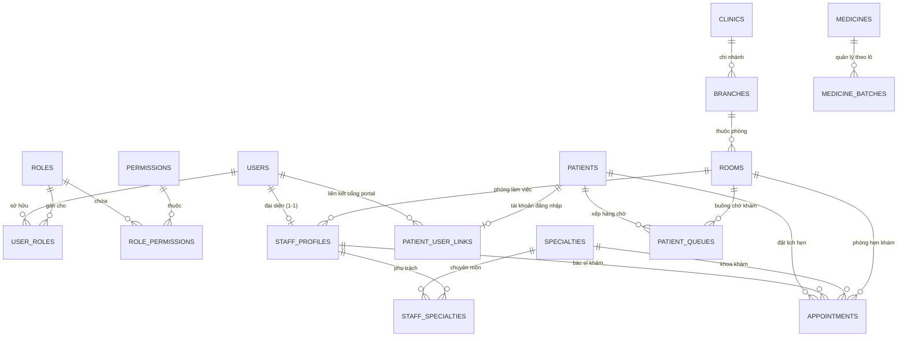

# HƯỚNG DẪN CƠ SỞ DỮ LIỆU PHÒNG KHÁM (DATABASE GUIDE)

> **Tài liệu đặc tả kiến trúc cơ sở dữ liệu MySQL 8.4 LTS & Flyway Migration**  
> Dự án: **Clinic Management System — Hệ thống Quản trị Phòng khám Đa khoa**  
> Phiên bản lược đồ: **v4.0.0 (Flyway V1 -> V4)**  
> Cập nhật lần cuối: **2026-11-03**

---

## 1. TỔNG QUAN HỆ THỐNG VÀ THÔNG SỐ KỸ THUẬT

Cơ sở dữ liệu của hệ thống Quản lý Phòng khám được thiết kế theo chuẩn **Modular Monolith**, đảm bảo tính toàn vẹn tham chiếu (Referential Integrity), hiệu năng đánh chỉ mục cao (B-Tree Indexing), và tuân thủ nghiêm ngặt các quy tắc bảo mật y tế (Medical Privacy, No Hard Delete, Audit Trail).

### Thông số kỹ thuật chính:
- **Hệ quản trị CSDL**: MySQL 8.0 / 8.4 LTS (InnoDB Storage Engine).
- **Bộ mã ký tự**: `utf8mb4` (hỗ trợ đầy đủ tiếng Việt, dấu thanh, emoji).
- **Collation**: `utf8mb4_unicode_ci`.
- **Cơ chế Migration**: Flyway Migration (`src/main/resources/db/migration`).
- **Mã định danh (Primary Key)**: `CHAR(36)` lưu UUID ngẫu nhiên v4, vừa đảm bảo tính duy nhất phân tán vừa bảo mật, không để lộ số lượng bản ghi thực tế qua ID tuần tự.
- **Tiền tệ & Tài chính**: `DECIMAL(19, 2)` (chuẩn tiền tệ VNĐ, tránh sai số số thực).
- **Số lượng thuốc / liều lượng**: `INT` (cho viên/hộp) hoặc `DECIMAL(12, 3)` (cho thể tích/khối lượng).

---

## 2. QUẢN LÝ PHIÊN BẢN VỚI FLYWAY (MIGRATION ROADMAP)

Lịch sử lược đồ cơ sở dữ liệu được kiểm soát chặt chẽ qua 4 tệp migration Flyway:

| Phiên bản | Tên tệp script | Mục đích & Nội dung | Số bảng tạo mới |
| :--- | :--- | :--- | :---: |
| **V1** | `V1__init_core_schema.sql` | Khởi tạo 18 bảng cốt lõi (User, Role, Permission, Clinic, Branch, Specialty, Room, Service, Medicine, Audit Log). | 18 |
| **V2** | `V2__seed_initial_data.sql` | Nạp dữ liệu nền tảng ban đầu (6 vai trò, 30 quyền hạn, tài khoản `admin`, phòng khám mẫu, 5 chuyên khoa, 6 phòng chức năng, 10 dịch vụ y tế, 5 thuốc cơ bản). | 0 |
| **V3** | `V3__init_patient_appointment_queue.sql` | Khởi tạo bảng `appointments` (lịch hẹn khám) và `patient_queues` (hàng chờ tiếp đón) với đầy đủ khóa ngoại và chỉ mục tối ưu. | 2 |
| **V4** | `V4__seed_comprehensive_demo_data.sql` | Nạp dữ liệu giả lập toàn diện (Idempotent seed): 10 tài khoản người dùng, 8 hồ sơ nhân viên y tế (5 bác sĩ), 25 bệnh nhân giả lập chuẩn Việt Nam, 25 lịch hẹn khám đa dạng trạng thái, 3 hàng chờ tiếp đón, 10 thuốc bổ sung (tổng 15 thuốc). | 0 |

---

## 3. SƠ ĐỒ THỰC THỂ MỐI QUAN HỆ (ERD - LOGICAL DIAGRAM)



---

## 4. CHI TIẾT CÁC MỐI QUAN HỆ TRỌNG YẾU

### 4.1. Tách biệt Người dùng (User Account) và Bệnh nhân (Patient Record)
- **Bảng `users`**: Quản lý thông tin xác thực (username, password hash BCrypt, email, active/suspended).
- **Bảng `patients`**: Quản lý thông tin nhân khẩu và lâm sàng (mã bệnh nhân `BN-YYYY-XXXX`, họ tên, ngày sinh, giới tính, CCCD, BHYT, nhóm máu, dị ứng).
- **Bảng `patient_user_links`**: Liên kết nhiều-1 hoặc 1-1 giữa tài khoản người dùng với hồ sơ bệnh nhân khi bệnh nhân kích hoạt cổng Patient Portal. Bệnh nhân vãng lai khám tại quầy tiếp đón **không bắt buộc** phải có tài khoản `users`.

### 4.2. Bác sĩ và Chuyên khoa (`staff_profiles` <-> `specialties`)
- Một bác sĩ có thể đảm nhiệm một hoặc nhiều chuyên khoa thông qua bảng trung gian `staff_specialties`.
- Cột `is_primary` (TINYINT) xác định chuyên khoa chính yếu của bác sĩ (ví dụ: Chuyên khoa Nội tổng quát, Tim mạch, Tai Mũi Họng).
- Bác sĩ được liên kết với một phòng khám mặc định (`room_id`) để tự động phân buồng khám khi phân luồng hàng chờ tiếp đón.

### 4.3. Bệnh nhân và Lịch hẹn (`patients` <-> `appointments`)
- Mỗi lượt hẹn có mã duy nhất định dạng `LH-YYYYMMDD-XXXX`.
- Khóa ngoại bắt buộc: `patient_id` (tham chiếu `patients.id`) và `specialty_id` (tham chiếu `specialties.id`).
- Khóa ngoại tùy chọn: `doctor_id` (nếu bệnh nhân chỉ định đích danh bác sĩ) và `room_id` (buồng khám tương ứng).
- Chu trình trạng thái lịch hẹn: `PENDING` -> `CONFIRMED` -> `CHECKED_IN` -> `IN_PROGRESS` -> `COMPLETED` (hoặc `CANCELLED` / `NO_SHOW`).

### 4.4. Phân quyền Người dùng và Vai trò (RBAC)
- Quan hệ nhiều-nhiều qua bảng `user_roles`. Một nhân viên có thể đồng thời giữ nhiều vai trò (ví dụ: vừa là `RECEPTIONIST` vừa là `CASHIER`).
- 6 vai trò tiêu chuẩn hệ thống:
  1. `ROLE_ADMIN`: Quản trị viên hệ thống (quản lý nhân viên, phòng ban, danh mục, cấu hình). *Lưu ý: Không tự ý đọc hồ sơ bệnh án theo nguyên tắc Clinical Privacy.*
  2. `ROLE_DOCTOR`: Bác sĩ lâm sàng (khám bệnh, ghi bệnh án, kê đơn, chỉ định xét nghiệm).
  3. `ROLE_RECEPTIONIST`: Nhân viên tiếp đón (check-in, phân luồng hàng chờ, tiếp nhận lịch hẹn).
  4. `ROLE_CASHIER`: Thu ngân (thu viện phí, lập hóa đơn, in biên lai thanh toán).
  5. `ROLE_PHARMACIST`: Dược sĩ (quản lý kho dược, nhập/xuất kho thuốc, cấp phát thuốc theo toa).
  6. `ROLE_PATIENT`: Bệnh nhân sử dụng Cổng thông tin (xem lịch sử khám, đơn thuốc, đặt lịch online).

### 4.5. Quản lý Dược phẩm và Kho thuốc
- Bảng `medicines`: Danh mục thuốc chuẩn với các thông tin: tên thương mại, tên hoạt chất (`generic_name`), nhóm dược lý, đơn vị tính, đơn giá bán, mức tồn kho cảnh báo tối thiểu (`min_stock_alert`), trạng thái kê đơn bắt buộc (`prescription_required`).
- Bảng `medicine_batches`: Quản lý thuốc theo từng lô nhập, số lô (`batch_number`), hạn sử dụng (`expiry_date`), giá nhập, số lượng nhập và tồn kho khả dụng của từng lô.
- **Quy tắc FEFO (First Expired, First Out)**: Khi cấp phát thuốc cho đơn điều trị, hệ thống tự động ưu tiên xuất kho từ các lô có hạn dùng gần nhất còn hạn (`expiry_date > CURRENT_DATE`).

---

## 5. DỮ LIỆU GIẢ LẬP DEMO (SYNTHETIC MEDICAL DATA)

Hệ thống đã nạp đầy đủ dữ liệu giả lập chuẩn Việt Nam (100% tuân thủ quy tắc không dùng dữ liệu bệnh nhân thật):

### 5.1. Danh sách Bác sĩ tiêu biểu (5 Bác sĩ)
| Mã NV | Họ tên bác sĩ | Học vị / Chuyên môn | Chuyên khoa | Phòng làm việc |
| :--- | :--- | :--- | :--- | :--- |
| `BS-001` | TS.BS. Trần Minh Anh | Tiến sĩ Y khoa, Giảng viên ĐHYD | Nội tổng quát | Phòng 101 (Phòng Khám Nội 1) |
| `BS-002` | ThS.BS. Nguyễn Phương Linh | Thạc sĩ Nhi khoa, BV Nhi Đồng | Nhi khoa | Phòng 201 (Phòng Khám Nhi) |
| `BS-003` | BSCKII. Lê Hoàng Nam | Bác sĩ Chuyên khoa 2 Tai Mũi Họng | Tai Mũi Họng | Phòng 202 (Phòng Tai Mũi Họng) |
| `BS-004` | BSCKI. Phạm Thu Hà | Bác sĩ Chuyên khoa 1 Da liễu | Da liễu | Phòng 102 (Phòng Khám Nội 2) |
| `BS-005` | ThS.BS. Vũ Tuấn Kiệt | Thạc sĩ Tim mạch học, Viện Tim | Tim mạch | Phòng 101 (Phòng Khám Nội 1) |

### 5.2. Danh mục Thuốc mẫu (15 Thuốc thiết yếu)
1. `MED-PARA-500`: Paracetamol 500mg (Giảm đau, hạ sốt) - Hộp 10 vỉ x 10 viên
2. `MED-AMOX-500`: Amoxicillin 500mg (Kháng sinh phổ rộng Aminopenicillin) - Hộp 10 vỉ
3. `MED-IBU-400`: Ibuprofen 400mg (Kháng viêm không steroid NSAID) - Hộp 10 vỉ
4. `MED-OMEP-20`: Omeprazole 20mg (Kháng tiết acid dạ dày PPI) - Hộp 3 vỉ x 10 viên
5. `MED-CEFU-500`: Cefuroxime Axetil 500mg (Kháng sinh Cephalosporin thế hệ 2)
6. `MED-LORA-10`: Loratadine 10mg (Kháng dị ứng Histamin H1)
7. `MED-METF-850`: Metformin HCl 850mg (Hạ đường huyết đái tháo đường Tuýp 2)
8. `MED-AMLO-5`: Amlodipine 5mg (Hạ huyết áp chẹn kênh Canxi)
9. `MED-ATOR-20`: Atorvastatin 20mg (Hạ lipid máu, điều trị rối loạn mỡ máu)
10. `MED-BERB-100`: Berberin 100mg (Điều trị tiêu chảy, nhiễm khuẩn đường tiêu hóa)
11. `MED-DEXT-15`: Dextromethorphan 15mg (Giảm ho khan, ức chế trung tâm ho)
12. `MED-SALB-100`: Salbutamol Inhaler 100mcg (Giãn phế quản cắt cơn hen)
13. `MED-KEM-CLO`: Kem Clotrimazole 1% (Thuốc bôi chống nấm da tại chỗ)
14. `MED-GEL-DIC`: Gel Diclofenac 1% (Kháng viêm giảm đau bôi ngoài khớp)
15. `MED-NACL-09`: Nước muối sinh lý NaCl 0.9% (Dung dịch rửa mắt mũi sát khuẩn)

### 5.3. 25 Bệnh nhân mẫu (`BN-2026-0001` đến `BN-2026-0025`)
Bao gồm đa dạng độ tuổi (từ trẻ em sơ sinh 2024 đến người cao tuổi 1955), đủ các nhóm máu (A+, B+, O+, AB+), kèm tiền sử dị ứng thực tế (Penicillin, Hải sản, Aspirin, Phấn hoa) và địa chỉ trải rộng các quận/huyện tại TP.HCM và khu vực lân cận.

### 5.4. 25 Lịch hẹn mẫu
Phân bổ đầy đủ các mốc thời gian (hôm qua, hôm nay, ngày mai và tuần sau), trải đều 5 trạng thái phục vụ kiểm thử phân luồng khám bệnh: `COMPLETED`, `IN_PROGRESS`, `CHECKED_IN`, `CONFIRMED`, `PENDING`, `CANCELLED`.

---

## 6. QUY TẮC BẢO MẬT VÀ TOÀN VẸN DỮ LIỆU (DATA INTEGRITY RULES)

1. **Không xóa vật lý (No Hard Delete)**:
   - Các bảng giao dịch y tế và hóa đơn không được phép thực hiện câu lệnh `DELETE FROM`. Mọi thao tác hủy đều chuyển trạng thái `status = 'CANCELLED'` hoặc cập nhật `deleted_at = NOW()`.
2. **Khóa chống xung đột tồn kho (Concurrency Control)**:
   - Mọi nghiệp vụ xuất kho cấp phát thuốc theo đơn phải chạy trong giao dịch Spring `@Transactional(isolation = Isolation.READ_COMMITTED)` và thực hiện Pessimistic Lock (`SELECT ... FOR UPDATE`) trên bảng `medicine_batches`.
3. **Mã hóa mật khẩu**:
   - Mọi mật khẩu người dùng lưu trong bảng `users` bắt buộc phải được băm bằng thuật toán **BCrypt** với độ sâu salt là 10. Tuyệt đối không bao giờ lưu mật khẩu dạng bản rõ (plaintext).
4. **Kiểm tra tính hợp lệ của Foreign Key**:
   - Khi tạo lịch hẹn, backend bắt buộc kiểm tra sự tồn tại của `patient_id` và `specialty_id`. Nếu vi phạm sẽ ném mã lỗi `PATIENT_NOT_FOUND` hoặc `NOT_FOUND` theo chuẩn RFC 7807.

---

## 7. HƯỚNG DẪN THỰC THI KIỂM THỬ TRÊN MYSQL

Mở công cụ MySQL Workbench, DBeaver, HeidiSQL hoặc terminal MySQL để chạy tệp kiểm tra toàn diện:

```bash
mysql -u root -p clinic_management < docs/VERIFY_DATABASE.sql
```

Tệp script sẽ lần lượt kiểm tra:
1. Lịch sử migration Flyway (đảm bảo cả 4 phiên bản đều `success = 1`).
2. Đếm số lượng bản ghi của tất cả 15 bảng chính.
3. Kiểm tra các câu truy vấn JOIN (Bệnh nhân - Lịch hẹn, Bác sĩ - Chuyên khoa, Tài khoản - Vai trò).
4. Kiểm tra không có bản ghi mồ côi (Orphan Records Check).

