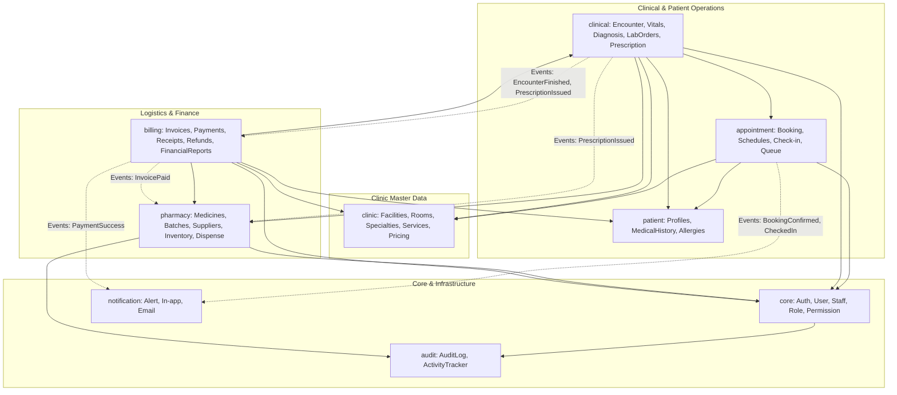

# TÀI LIỆU THIẾT KẾ KIẾN TRÚC HỆ THỐNG (ARCHITECTURE.MD)

> **Dự án**: Clinic Management System (Hệ thống Quản lý Phòng khám Đa khoa / Chuyên khoa Tư nhân)  
> **Kiến trúc**: Modular Monolith  
> **Môi trường vận hành**: Windows 10/11 Server / Desktop Environment  
> **Phiên bản**: 1.0.0 | Ngày lập: 2026-10-15

---

## 1. TỔNG QUAN HỆ THỐNG VÀ BỐI CẢNH NGHIỆP VỤ

### 1.1. Mục tiêu hệ thống
Hệ thống Quản lý Phòng khám (**Clinic Management System - CMS**) được xây dựng nhằm tin học hóa và tối ưu hóa toàn bộ chu trình khám chữa bệnh tại các cơ sở phòng khám tư nhân, từ khâu tiếp đón ban đầu, đặt lịch hẹn trực tuyến, khám lâm sàng/cận lâm sàng của bác sĩ, quản lý đơn thuốc và kho dược, thu ngân thanh toán, đến cổng tra cứu thông tin dành cho bệnh nhân.

### 1.2. 6 Vai trò người dùng (Roles)
Hệ thống phục vụ 6 nhóm đối tượng với quyền hạn và ranh giới nghiệp vụ riêng biệt:
1. **ADMIN (Quản trị viên hệ thống)**: Quản lý người dùng, phân quyền, cấu hình phòng khám, chuyên khoa, phòng ốc, danh mục dịch vụ, bảng giá, giám sát audit log và các báo cáo vận hành cấp cao.
2. **RECEPTIONIST (Nhân viên Tiếp tân)**: Tiếp nhận bệnh nhân, tìm kiếm/đăng ký hồ sơ, tiếp nhận lịch hẹn trực tuyến, cấp số thứ tự vào hàng chờ (Queue), hỗ trợ thu viện phí cơ bản (nếu được cấp quyền).
3. **DOCTOR (Bác sĩ khám bệnh)**: Xem danh sách chờ khám, tiếp nhận lượt khám (Encounter), đo đạc/ghi nhận sinh hiệu, ghi nhận bệnh sử, chẩn đoán bệnh (mã ICD-10), chỉ định cận lâm sàng (xét nghiệm, chẩn đoán hình ảnh), kê đơn thuốc điện tử, hẹn ngày tái khám.
4. **CASHIER (Nhân viên Thu ngân)**: Tạo/quản lý hóa đơn dịch vụ y tế và thuốc, thu tiền đa hình thức (tiền mặt, chuyển khoản, thẻ), in phiếu thu/biên lai, theo dõi công nợ, xử lý hoàn tiền (refund) theo phê duyệt.
5. **PHARMACIST (Dược sĩ / Thủ kho dược)**: Quản lý danh mục dược phẩm, nhà cung cấp, nhập kho theo số lô và hạn dùng (Batch & Expiry Date), xuất kho cấp phát thuốc theo đơn của bác sĩ, kiểm kê tồn kho và cảnh báo thuốc sắp hết hạn.
6. **PATIENT (Bệnh nhân / Người nhà)**: Quản lý tài khoản cá nhân, đặt lịch khám trực tuyến, theo dõi tiến trình khám, tra cứu lịch sử bệnh án, xem đơn thuốc, xem hóa đơn và thanh toán trực tuyến.

---

## 2. LỰA CHỌN CÔNG NGHỆ VÀ LẬP LUẬN THIẾT KẾ (TECH STACK)

| Thành phần | Công nghệ lựa chọn | Lý do và ưu điểm kỹ thuật |
| :--- | :--- | :--- |
| **Backend Core** | Java 21 LTS | Hiệu năng cao, Virtual Threads (Project Loom) tối ưu xử lý I/O đồng thời, tính năng Record class, Pattern matching giúp code ngắn gọn, type-safe và ổn định lâu dài. |
| **Backend Framework** | Spring Boot 3.3.x / 3.4.x | Hệ sinh thái hoàn thiện, tích hợp sẵn Spring Security 6, Spring Data JPA, quản lý cấu hình và lifecycle mạnh mẽ, cộng đồng lớn, tương thích hoàn hảo Java 21. |
| **ORM & Persistence** | Hibernate 6 + Spring Data JPA | Giảm thiểu boilerplate code truy vấn, hỗ trợ dirty checking, batch insert/update, caching tầng 1 và tầng 2, cơ chế khóa `@Lock` (Pessimistic/Optimistic). |
| **Database Migration** | Flyway 10.x | Quản lý phiên bản schema dạng code-first, theo dõi lịch sử thay đổi schema chặt chẽ, dễ rollback/deploy trên môi trường staging và production. |
| **Database Engine** | MySQL 8.4 LTS | Phiên bản Long Term Support mới nhất của MySQL, hỗ trợ InnoDB engine, giao dịch ACID, JSON functions, window functions, và bộ ký tự đầy đủ `utf8mb4`. |
| **Frontend Framework** | React 18 / 19 + TypeScript | Hệ sinh thái component phong phú, TypeScript đảm bảo chặt chẽ kiểu dữ liệu, giảm thiểu lỗi runtime cho các biểu mẫu y tế phức tạp. |
| **Build Tool Frontend** | Vite 5.x / 6.x | Tốc độ Hot Module Replacement (HMR) cực nhanh, tối ưu hóa bundle size với Rollup, thiết lập đơn giản. |
| **Styling & UI Kit** | Tailwind CSS + shadcn/ui | Tùy biến linh hoạt cao, component copy-paste nguyên bản dễ kiểm soát, chuẩn Accessibility (Radix UI), giao diện hiện đại, dễ dàng hỗ trợ Dark/Light mode. |
| **Data Fetching & State** | TanStack Query v5 + Axios | Tự động caching, revalidation ngầm, quản lý trạng thái loading/error cực tốt, giảm tải request thừa cho hệ thống. |
| **Form & Validation** | React Hook Form + Zod | Hiệu năng render tối ưu (uncontrolled inputs), validate schema đồng nhất giữa client và server specification, hỗ trợ các form bệnh án nhiều trường phức tạp. |
| **Data Visualization** | Recharts | Thư viện biểu đồ xây dựng trên nền React và SVG, trực quan hóa biểu đồ doanh thu phòng khám, số lượng bệnh nhân, và theo dõi chỉ số sinh hiệu theo thời gian. |

---

## 3. KIẾN TRÚC TỔNG THỂ: MODULAR MONOLITH

Hệ thống được thiết kế theo mô hình **Modular Monolith**. Tất cả các module được đóng gói trong một ứng dụng duy nhất nhưng có **ranh giới ngữ cảnh rõ ràng (Bounded Contexts)**, độc lập về mặt logic nghiệp vụ và chỉ tương tác thông qua các Public Service Interface hoặc Event Bus nội bộ.

### 3.1. Sơ đồ các Module và Quan hệ Phụ thuộc (Mermaid)



### 3.2. Chi tiết phân rã các Module (Module Boundaries)

| Module | Trách nhiệm chính (Single Responsibility) | Giao tiếp đối ngoại |
| :--- | :--- | :--- |
| **Core Module** | Xác thực JWT, quản lý tài khoản User, Staff, phân quyền Role & Permission. | Cung cấp `UserPrincipal`, `SecurityService`, kiểm tra quyền hạn cho toàn hệ thống. |
| **Clinic Module** | Quản lý danh mục cơ sở, chuyên khoa, phòng khám/phòng xét nghiệm, danh mục dịch vụ kỹ thuật và bảng giá. | Cung cấp danh mục dịch vụ và giá cho `Billing` và `Clinical`. |
| **Patient Module** | Hồ sơ hành chính bệnh nhân, tiền sử bệnh tật, tiền sử dị ứng thuốc, thông tin liên hệ khẩn cấp. | Cung cấp dữ liệu bệnh nhân cho `Appointment`, `Clinical`, `Billing`. |
| **Appointment Module** | Lịch làm việc của bác sĩ, đặt lịch hẹn, tiếp đón check-in, điều phối hàng chờ (Queue Management). | Kích hoạt tạo Lượt khám `Encounter` khi bệnh nhân được gọi vào phòng. |
| **Clinical Module** | Toàn bộ quá trình thăm khám: Lượt khám (Encounter), chỉ số sinh hiệu (Vitals), chẩn đoán ICD-10, chỉ định cận lâm sàng, kê đơn thuốc. | Gửi thông tin đơn thuốc sang `Pharmacy` và chi phí dịch vụ/thuốc sang `Billing`. |
| **Pharmacy Module** | Quản lý danh mục thuốc, nhà cung cấp, nhập kho (PO), theo dõi tồn kho theo Lô (Batch) & Hạn dùng (Expiry Date), xuất cấp phát thuốc. | Cung cấp giá thuốc cho `Billing`, trừ tồn kho khi đơn thuốc được cấp phát. |
| **Billing Module** | Quản lý hóa đơn (Invoice), chi tiết hóa đơn (Line Items), biên lai thu tiền (Payment Receipts), hoàn tiền (Refunds), công nợ. | Nhận yêu cầu thanh toán từ `Clinical` và `Pharmacy`, phát hành hóa đơn điện tử/biên lai. |
| **Notification Module** | Phát và lưu trữ thông báo in-app, tích hợp gửi email/SMS thông báo lịch khám, kết quả khám. | Lắng nghe Domain Events từ các module khác. |
| **Audit Module** | Ghi nhận bất biến (Append-only) mọi hành vi tạo, sửa, xóa, truy cập dữ liệu y tế và tài chính nhạy cảm. | AOP Interceptor tự động bắt các action nhạy cảm. |

---

## 4. QUY TẮC TƯƠNG TÁC GIỮA CÁC MODULE (DECOUPLING RULES)

1. **Không truy cập Repository chéo (No Cross-Module Repository Access)**:
   - Module `Billing` tuyệt đối không được `@Autowired ClinicalEncounterRepository`. Nếu cần thông tin khám, `Billing` phải gọi qua `ClinicalQueryService` (Interface công khai của module `Clinical`).
2. **Sử dụng DTO độc lập (Independent DTOs)**:
   - Dữ liệu trả về qua ranh giới module phải là Plain DTO/Record, không trả về Managed JPA Entity để tránh hiện tượng LazyInitializationException ngoài context và làm lộ cấu trúc bảng nội bộ.
3. **Phát tán sự kiện nội bộ (Spring Application Events)**:
   - Khi Bác sĩ hoàn thành khám và kê đơn (`PrescriptionIssuedEvent`), hệ thống phát sự kiện nội bộ. Module `Billing` lắng nghe để tự động tạo hóa đơn chờ thanh toán (`INVOICE_PENDING`). Module `Pharmacy` nhận sự kiện để chuẩn bị danh sách chờ cấp phát.

---

## 5. THIẾT KẾ KIẾN TRÚC FRONTEND

### 5.1. Mô hình Phân chia Layout và Cổng vào (Portals)
Hệ thống Frontend chia làm 2 phân hệ trải nghiệm chính:

```
[React SPA Root]
 ├── /auth/login, /auth/register, /auth/forgot-password (Auth Layout)
 ├── /portal/* (Patient Portal Layout - Tối ưu cho Điện thoại & Máy tính)
 │    ├── /portal/dashboard (Tổng quan sức khỏe)
 │    ├── /portal/appointments (Đặt lịch & Lịch hẹn của tôi)
 │    ├── /portal/medical-records (Lịch sử khám & Đơn thuốc)
 │    └── /portal/invoices (Hóa đơn & Biên lai)
 └── /admin/* | /app/* (Internal Staff Dashboard Layout - Tối ưu cho Desktop & Màn hình làm việc chuyên nghiệp)
      ├── Topbar: Thông tin chi nhánh, Chuông thông báo, Profile, Chuyển vai trò (nếu đa vai trò)
      ├── Sidebar Navigation: Tự động lọc menu dựa trên Role & Permissions của người dùng
      └── Main Workspace: Giao diện nghiệp vụ theo vai trò (Bác sĩ, Tiếp tân, Thu ngân, Dược sĩ, Quản trị)
```

### 5.2. Quản lý Trạng thái (State Management Strategy)
- **Server State (Dữ liệu máy chủ)**: Quản lý 100% bằng `@tanstack/react-query`. Cấu hình `staleTime: 60_000` (1 phút) cho danh mục ít thay đổi, `staleTime: 5_000` cho hàng chờ tiếp đón và thông báo.
- **Client State (Trạng thái giao diện)**: 
  - Trạng thái người dùng, vai trò hiện tại, theme (Light/Dark): Lưu trong `AuthContext` / `ThemeContext`.
  - Bộ lọc tìm kiếm, phân trang: Đồng bộ trực tiếp lên URL Query Parameters (`useSearchParams`) để dễ dàng bookmark và chia sẻ liên kết.

### 5.3. Bảo vệ Điều hướng và Phân quyền Giao diện (Route Guards)
- Component `<ProtectedRoute>` kiểm tra token hợp lệ.
- Component `<RoleGuard allowedRoles={[Role.DOCTOR]}>` bảo vệ route chỉ dành cho Bác sĩ.
- Component `<PermissionGuard permission="INVOICE:CREATE">` kiểm soát ẩn/hiện từng nút bấm thao tác trên giao diện.

---

## 6. THIẾT KẾ BẢO MẬT VÀ PHÂN QUYỀN TRUY CẬP (SECURITY ARCHITECTURE)

### 6.1. Xác thực (Authentication Flow)
1. Người dùng gửi credentials (username/password) đến `/api/v1/auth/login`.
2. Hệ thống kiểm tra mật khẩu (BCrypt), nếu thất bại 5 lần liên tiếp -> Khóa tài khoản tạm thời 15 phút.
3. Nếu thành công -> Sinh cặp khóa:
   - **Access Token**: JWT ký thuật toán HMAC-SHA256, thời hạn 15 phút, chứa `userId`, `username`, danh sách `roles` và `permissions`.
   - **Refresh Token**: Chuỗi ngẫu nhiên bảo mật lưu trong DB với thời hạn 7 ngày, gửi về client qua `HttpOnly Secure Cookie` để ngăn chặn rò rỉ XSS.

### 6.2. Ranh giới Bảo mật Bệnh án (Clinical Data Privacy)
- **ADMIN**: Chỉ có quyền quản trị tài nguyên cấu hình, bảng giá, người dùng, xem thống kê tổng hợp (KPI doanh thu, số lượt khám). Admin **KHÔNG** có quyền truy cập API `/api/v1/clinical/encounters/{id}` để đọc nội dung bệnh án, chẩn đoán, hoặc hình ảnh nhạy cảm của người bệnh.
- **DOCTOR**: Chỉ được xem chi tiết bệnh án của bệnh nhân nếu:
  1. Là bác sĩ trực tiếp tiếp nhận lượt khám đó, HOẶC
  2. Bệnh nhân đang được phân công vào phòng khám của bác sĩ trong ngày hôm đó, HOẶC
  3. Được yêu cầu hội chẩn (ghi nhận vào audit log).
- **PATIENT**: Chỉ có quyền đọc dữ liệu của chính mình (`patient.user_id == current_user.id`).

---

## 7. CHIẾN LƯỢC TOÀN VẸN DỮ LIỆU VÀ ĐỒNG THỜI (CONCURRENCY & TRANSACTION)

### 7.1. Quản lý Kho Dược & Ngăn ngừa Bán Quá Số Lượng (Overselling)
- Khi Dược sĩ xuất kho thuốc theo đơn hoặc Bác sĩ giữ chỗ thuốc, hệ thống thực hiện trừ tồn kho theo lô (`medicine_batches`).
- **Chiến lược Locking**: Sử dụng **Pessimistic Write Lock** (`SELECT ... FOR UPDATE` thông qua `@Lock(LockModeType.PESSIMISTIC_WRITE)`) trên bảng `medicine_batches` trong phạm vi `@Transactional` để đảm bảo không xảy ra xung đột khi 2 quầy cùng xuất một lô thuốc còn số lượng ít.

### 7.2. Xử lý Giao dịch Thanh toán (Financial Idempotency)
- Bảng `invoices` và `payments` áp dụng trường `idempotency_key` (hoặc transaction code duy nhất).
- Tránh việc click kép nút thanh toán dẫn đến trừ tiền hoặc phát hành biên lai trùng lặp.

---

## 8. CÁC GIẢ ĐỊNH THIẾT KẾ (DESIGN ASSUMPTIONS)

1. **Quy mô phòng khám**: Thiết kế phục vụ phòng khám quy mô vừa và nhỏ (1 - 5 chi nhánh, 10 - 50 bác sĩ/nhân viên, 200 - 1.000 lượt khám/ngày). Mô hình Modular Monolith là tối ưu nhất về chi phí vận hành, tính dễ bảo trì và khả năng phát triển nhanh.
2. **Tiền tệ và Thuế**: Hệ thống hạch toán theo đồng Việt Nam (VNĐ). Mọi khoản tiền được lưu dưới dạng số nguyên lớn hoặc thập phân 2 chữ số (`DECIMAL(15,2)`). Mặc định giá dịch vụ và thuốc đã bao gồm thuế VAT (hoặc có trường `vat_rate` rõ ràng).
3. **Mã số định danh**:
   - Bệnh nhân: Sinh mã tự động `BN-YYYYMMDD-XXXX`.
   - Lượt khám: `LK-YYYYMMDD-XXXX`.
   - Hóa đơn: `HD-YYYYMMDD-XXXX`.
   - Đơn thuốc: `DT-YYYYMMDD-XXXX`.
4. **Mã hóa bệnh tật**: Sử dụng danh mục chuẩn **ICD-10** (International Classification of Diseases, 10th Revision) cho các mã chẩn đoán chính và kèm theo.
