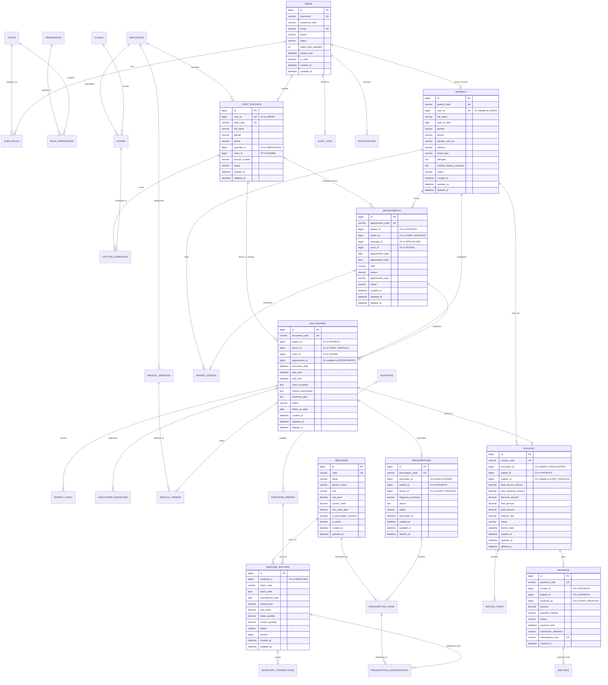

# THIẾT KẾ CƠ SỞ DỮ LIỆU TỔNG THỂ (ERD.MD)

> **Hệ quản trị cơ sở dữ liệu**: MySQL 8.4 LTS  
> **Engine**: InnoDB | **Bộ mã ký tự**: utf8mb4 | **Collation**: utf8mb4_unicode_ci  
> **Phiên bản**: 1.0.0 | Ngày lập: 2026-10-15

---

## 1. SƠ ĐỒ THỰC THỂ - QUAN HỆ (MERMAID ER DIAGRAM)

---

## 2. ĐẶC TẢ CHI TIẾT CÁC BẢNG DỮ LIỆU (DATABASE SCHEMAS)

### 2.1. Phân hệ Định danh & Phân quyền (Core & RBAC)

#### Bảng `users`
Lưu trữ thông tin tài khoản đăng nhập (cả nhân viên phòng khám và bệnh nhân).
- `id` (BIGINT, AUTO_INCREMENT, PK)
- `username` (VARCHAR(50), NOT NULL, UNIQUE, Index)
- `password_hash` (VARCHAR(255), NOT NULL) - BCrypt hash
- `email` (VARCHAR(100), NULL, UNIQUE, Index)
- `phone` (VARCHAR(20), NULL, Index)
- `status` (VARCHAR(20), NOT NULL, DEFAULT 'ACTIVE') - `ACTIVE`, `SUSPENDED`, `LOCKED`
- `failed_login_attempts` (INT, NOT NULL, DEFAULT 0)
- `locked_until` (DATETIME, NULL)
- `is_staff` (BOOLEAN, NOT NULL, DEFAULT FALSE)
- `created_at` (DATETIME, NOT NULL, DEFAULT CURRENT_TIMESTAMP)
- `updated_at` (DATETIME, NOT NULL, DEFAULT CURRENT_TIMESTAMP ON UPDATE CURRENT_TIMESTAMP)

#### Bảng `roles`
- `id` (BIGINT, AUTO_INCREMENT, PK)
- `code` (VARCHAR(30), NOT NULL, UNIQUE) - `ROLE_ADMIN`, `ROLE_RECEPTIONIST`, `ROLE_DOCTOR`, `ROLE_CASHIER`, `ROLE_PHARMACIST`, `ROLE_PATIENT`
- `name` (VARCHAR(100), NOT NULL) - Tên hiển thị Tiếng Việt
- `description` (VARCHAR(255), NULL)
- `is_system` (BOOLEAN, NOT NULL, DEFAULT TRUE)
- `created_at` (DATETIME, NOT NULL, DEFAULT CURRENT_TIMESTAMP)

#### Bảng `permissions`
- `id` (BIGINT, AUTO_INCREMENT, PK)
- `code` (VARCHAR(60), NOT NULL, UNIQUE) - Ví dụ: `ENCOUNTER:READ`, `ENCOUNTER:CREATE`, `INVOICE:PAY`
- `name` (VARCHAR(100), NOT NULL)
- `module` (VARCHAR(50), NOT NULL) - `CORE`, `CLINICAL`, `PHARMACY`, `BILLING`, v.v.
- `description` (VARCHAR(255), NULL)

#### Bảng `user_roles`
- `user_id` (BIGINT, NOT NULL, FK -> `users.id` ON DELETE CASCADE)
- `role_id` (BIGINT, NOT NULL, FK -> `roles.id` ON DELETE CASCADE)
- **Primary Key**: `(user_id, role_id)`

#### Bảng `role_permissions`
- `role_id` (BIGINT, NOT NULL, FK -> `roles.id` ON DELETE CASCADE)
- `permission_id` (BIGINT, NOT NULL, FK -> `permissions.id` ON DELETE CASCADE)
- **Primary Key**: `(role_id, permission_id)`

#### Bảng `staff_profiles`
Hồ sơ nhân viên (Bác sĩ, Tiếp tân, Thu ngân, Dược sĩ, Quản trị).
- `id` (BIGINT, AUTO_INCREMENT, PK)
- `user_id` (BIGINT, NOT NULL, UNIQUE, FK -> `users.id`)
- `staff_code` (VARCHAR(30), NOT NULL, UNIQUE, Index) - Ví dụ: `NV-001`, `BS-012`
- `full_name` (VARCHAR(100), NOT NULL)
- `gender` (VARCHAR(10), NOT NULL) - `MALE`, `FEMALE`, `OTHER`
- `date_of_birth` (DATE, NULL)
- `phone` (VARCHAR(20), NOT NULL)
- `specialty_id` (BIGINT, NULL, FK -> `specialties.id`)
- `room_id` (BIGINT, NULL, FK -> `rooms.id`) - Phòng làm việc mặc định
- `license_number` (VARCHAR(50), NULL) - Số chứng chỉ hành nghề y
- `status` (VARCHAR(20), NOT NULL, DEFAULT 'ACTIVE') - `ACTIVE`, `ON_LEAVE`, `TERMINATED`
- `created_at` (DATETIME, NOT NULL, DEFAULT CURRENT_TIMESTAMP)
- `updated_at` (DATETIME, NOT NULL, DEFAULT CURRENT_TIMESTAMP ON UPDATE CURRENT_TIMESTAMP)

---

### 2.2. Phân hệ Hồ sơ Bệnh nhân (Patient Domain)

#### Bảng `patients`
Hồ sơ hành chính và nhân khẩu của bệnh nhân (độc lập với tài khoản đăng nhập).
- `id` (BIGINT, AUTO_INCREMENT, PK)
- `patient_code` (VARCHAR(30), NOT NULL, UNIQUE, Index) - Mã bệnh nhân y tế (ví dụ: `BN-20261015-0001`)
- `user_id` (BIGINT, NULL, UNIQUE, FK -> `users.id` ON DELETE SET NULL) - Liên kết tài khoản cổng bệnh nhân
- `full_name` (VARCHAR(100), NOT NULL, Index)
- `date_of_birth` (DATE, NOT NULL, Index)
- `gender` (VARCHAR(10), NOT NULL) - `MALE`, `FEMALE`, `OTHER`
- `phone` (VARCHAR(20), NOT NULL, Index)
- `identity_card_no` (VARCHAR(25), NULL, Index) - Số CCCD/Hộ chiếu
- `email` (VARCHAR(100), NULL)
- `address` (VARCHAR(255), NULL)
- `emergency_contact_name` (VARCHAR(100), NULL)
- `emergency_contact_phone` (VARCHAR(20), NULL)
- `blood_type` (VARCHAR(10), NULL) - `A+`, `O+`, `B+`, `AB+`, `A-`, `O-`, `B-`, `AB-`
- `allergies` (TEXT, NULL) - Tiền sử dị ứng (thuốc, thức ăn, môi trường)
- `medical_history_summary` (TEXT, NULL) - Tiền sử bệnh án gia đình & bản thân
- `status` (VARCHAR(20), NOT NULL, DEFAULT 'ACTIVE') - `ACTIVE`, `DECEASED`, `ARCHIVED`
- `created_by` (BIGINT, NULL)
- `created_at` (DATETIME, NOT NULL, DEFAULT CURRENT_TIMESTAMP)
- `updated_at` (DATETIME, NOT NULL, DEFAULT CURRENT_TIMESTAMP ON UPDATE CURRENT_TIMESTAMP)
- `deleted_at` (DATETIME, NULL, Index)
- `deleted_by` (BIGINT, NULL)

---

### 2.3. Phân hệ Quản trị Cơ sở & Danh mục (Clinic Master Data)

#### Bảng `clinics`
- `id` (BIGINT, AUTO_INCREMENT, PK)
- `code` (VARCHAR(30), NOT NULL, UNIQUE)
- `name` (VARCHAR(150), NOT NULL)
- `address` (VARCHAR(255), NOT NULL)
- `phone` (VARCHAR(20), NOT NULL)
- `email` (VARCHAR(100), NULL)
- `is_active` (BOOLEAN, NOT NULL, DEFAULT TRUE)
- `created_at` (DATETIME, NOT NULL, DEFAULT CURRENT_TIMESTAMP)
- `updated_at` (DATETIME, NOT NULL, DEFAULT CURRENT_TIMESTAMP ON UPDATE CURRENT_TIMESTAMP)

#### Bảng `specialties`
- `id` (BIGINT, AUTO_INCREMENT, PK)
- `code` (VARCHAR(30), NOT NULL, UNIQUE) - Ví dụ: `NOI`, `NGOAI`, `NHI`, `TAI_MUI_HONG`
- `name` (VARCHAR(100), NOT NULL)
- `description` (TEXT, NULL)
- `is_active` (BOOLEAN, NOT NULL, DEFAULT TRUE)
- `created_at` (DATETIME, NOT NULL, DEFAULT CURRENT_TIMESTAMP)
- `updated_at` (DATETIME, NOT NULL, DEFAULT CURRENT_TIMESTAMP ON UPDATE CURRENT_TIMESTAMP)

#### Bảng `rooms`
- `id` (BIGINT, AUTO_INCREMENT, PK)
- `clinic_id` (BIGINT, NOT NULL, FK -> `clinics.id`)
- `specialty_id` (BIGINT, NULL, FK -> `specialties.id`)
- `code` (VARCHAR(30), NOT NULL, UNIQUE) - Ví dụ: `P101`, `P202_XQUANG`
- `name` (VARCHAR(100), NOT NULL)
- `room_type` (VARCHAR(30), NOT NULL) - `EXAM`, `LAB`, `RADIOLOGY`, `PHARMACY`, `RECEPTION`, `CASHIER`
- `is_active` (BOOLEAN, NOT NULL, DEFAULT TRUE)
- `created_at` (DATETIME, NOT NULL, DEFAULT CURRENT_TIMESTAMP)
- `updated_at` (DATETIME, NOT NULL, DEFAULT CURRENT_TIMESTAMP ON UPDATE CURRENT_TIMESTAMP)

#### Bảng `medical_services`
- `id` (BIGINT, AUTO_INCREMENT, PK)
- `code` (VARCHAR(30), NOT NULL, UNIQUE, Index) - Ví dụ: `DV_KHAM_NOI`, `XN_CTM`, `XQ_TIM_PHOI`
- `name` (VARCHAR(150), NOT NULL)
- `specialty_id` (BIGINT, NULL, FK -> `specialties.id`)
- `service_type` (VARCHAR(30), NOT NULL) - `EXAM`, `LAB`, `RADIOLOGY`, `PROCEDURE`
- `base_price` (DECIMAL(15,2), NOT NULL)
- `description` (TEXT, NULL)
- `is_active` (BOOLEAN, NOT NULL, DEFAULT TRUE)
- `created_at` (DATETIME, NOT NULL, DEFAULT CURRENT_TIMESTAMP)
- `updated_at` (DATETIME, NOT NULL, DEFAULT CURRENT_TIMESTAMP ON UPDATE CURRENT_TIMESTAMP)

---

### 2.4. Phân hệ Lịch hẹn & Hàng chờ Tiếp đón (Appointment & Queue)

#### Bảng `doctor_schedules`
- `id` (BIGINT, AUTO_INCREMENT, PK)
- `doctor_id` (BIGINT, NOT NULL, FK -> `staff_profiles.id`)
- `room_id` (BIGINT, NOT NULL, FK -> `rooms.id`)
- `work_date` (DATE, NOT NULL, Index)
- `shift` (VARCHAR(20), NOT NULL) - `MORNING`, `AFTERNOON`, `EVENING`
- `start_time` (TIME, NOT NULL)
- `end_time` (TIME, NOT NULL)
- `max_patients` (INT, NOT NULL, DEFAULT 30)
- `status` (VARCHAR(20), NOT NULL, DEFAULT 'AVAILABLE') - `AVAILABLE`, `FULL`, `OFF`
- `created_at` (DATETIME, NOT NULL, DEFAULT CURRENT_TIMESTAMP)
- `updated_at` (DATETIME, NOT NULL, DEFAULT CURRENT_TIMESTAMP ON UPDATE CURRENT_TIMESTAMP)
- **Composite Index**: `idx_doctor_work_date (doctor_id, work_date)`

#### Bảng `appointments`
- `id` (BIGINT, AUTO_INCREMENT, PK)
- `appointment_code` (VARCHAR(30), NOT NULL, UNIQUE, Index) - Ví dụ: `LH-20261015-001`
- `patient_id` (BIGINT, NOT NULL, FK -> `patients.id`, Index)
- `doctor_id` (BIGINT, NULL, FK -> `staff_profiles.id`, Index)
- `specialty_id` (BIGINT, NOT NULL, FK -> `specialties.id`)
- `room_id` (BIGINT, NULL, FK -> `rooms.id`)
- `appointment_date` (DATE, NOT NULL, Index)
- `appointment_time` (TIME, NOT NULL)
- `shift` (VARCHAR(20), NOT NULL)
- `reason` (TEXT, NULL)
- `appointment_type` (VARCHAR(20), NOT NULL) - `ONLINE_PORTAL`, `WALK_IN`, `PHONE`
- `status` (VARCHAR(30), NOT NULL, DEFAULT 'PENDING', Index) - `PENDING`, `CONFIRMED`, `CHECKED_IN`, `IN_PROGRESS`, `COMPLETED`, `CANCELLED`, `NO_SHOW`
- `cancellation_reason` (VARCHAR(255), NULL)
- `created_by` (BIGINT, NULL)
- `created_at` (DATETIME, NOT NULL, DEFAULT CURRENT_TIMESTAMP)
- `updated_at` (DATETIME, NOT NULL, DEFAULT CURRENT_TIMESTAMP ON UPDATE CURRENT_TIMESTAMP)
- `deleted_at` (DATETIME, NULL)

#### Bảng `patient_queues`
- `id` (BIGINT, AUTO_INCREMENT, PK)
- `clinic_id` (BIGINT, NOT NULL, FK -> `clinics.id`)
- `room_id` (BIGINT, NOT NULL, FK -> `rooms.id`, Index)
- `appointment_id` (BIGINT, NULL, FK -> `appointments.id`)
- `patient_id` (BIGINT, NOT NULL, FK -> `patients.id`)
- `queue_number` (INT, NOT NULL)
- `queue_date` (DATE, NOT NULL, Index)
- `priority` (VARCHAR(20), NOT NULL, DEFAULT 'NORMAL') - `NORMAL`, `EMERGENCY`, `ELDERLY`, `PREGNANT`
- `status` (VARCHAR(20), NOT NULL, DEFAULT 'WAITING', Index) - `WAITING`, `CALLING`, `IN_CONSULTATION`, `COMPLETED`, `SKIPPED`
- `called_at` (DATETIME, NULL)
- `completed_at` (DATETIME, NULL)
- `created_at` (DATETIME, NOT NULL, DEFAULT CURRENT_TIMESTAMP)
- `updated_at` (DATETIME, NOT NULL, DEFAULT CURRENT_TIMESTAMP ON UPDATE CURRENT_TIMESTAMP)
- **Unique Constraint**: `uk_room_date_number (room_id, queue_date, queue_number)`

---

### 2.5. Phân hệ Thăm khám Lâm sàng & Bệnh án (Clinical Domain)

#### Bảng `encounters` (Lượt khám bệnh)
- `id` (BIGINT, AUTO_INCREMENT, PK)
- `encounter_code` (VARCHAR(30), NOT NULL, UNIQUE, Index) - Ví dụ: `LK-20261015-001`
- `patient_id` (BIGINT, NOT NULL, FK -> `patients.id`, Index)
- `doctor_id` (BIGINT, NOT NULL, FK -> `staff_profiles.id`, Index)
- `room_id` (BIGINT, NOT NULL, FK -> `rooms.id`)
- `appointment_id` (BIGINT, NULL, UNIQUE, FK -> `appointments.id`)
- `encounter_date` (DATETIME, NOT NULL, Index)
- `start_time` (DATETIME, NOT NULL)
- `end_time` (DATETIME, NULL)
- `chief_complaint` (TEXT, NOT NULL) - Lý do vào khám
- `clinical_examination` (TEXT, NULL) - Khám toàn thân, khám cơ quan
- `treatment_plan` (TEXT, NULL) - Kế hoạch điều trị
- `doctor_notes` (TEXT, NULL) - Lời dặn
- `status` (VARCHAR(30), NOT NULL, DEFAULT 'IN_PROGRESS', Index) - `IN_PROGRESS`, `PENDING_LABS`, `COMPLETED`, `CANCELLED`
- `follow_up_date` (DATE, NULL)
- `created_at` (DATETIME, NOT NULL, DEFAULT CURRENT_TIMESTAMP)
- `updated_at` (DATETIME, NOT NULL, DEFAULT CURRENT_TIMESTAMP ON UPDATE CURRENT_TIMESTAMP)
- `deleted_at` (DATETIME, NULL)

#### Bảng `patient_vitals` (Chỉ số sinh hiệu)
- `id` (BIGINT, AUTO_INCREMENT, PK)
- `encounter_id` (BIGINT, NOT NULL, FK -> `encounters.id`, Index)
- `patient_id` (BIGINT, NOT NULL, FK -> `patients.id`, Index)
- `temperature` (DECIMAL(4,1), NULL) - Nhiệt độ (°C)
- `blood_pressure_systolic` (INT, NULL) - Huyết áp tâm thu (mmHg)
- `blood_pressure_diastolic` (INT, NULL) - Huyết áp tâm trương (mmHg)
- `heart_rate` (INT, NULL) - Nhịp tim (lần/phút)
- `respiratory_rate` (INT, NULL) - Nhịp thở (lần/phút)
- `sp_o2` (DECIMAL(4,1), NULL) - Nồng độ oxy trong máu (%)
- `weight_kg` (DECIMAL(5,2), NULL) - Cân nặng (kg)
- `height_cm` (DECIMAL(5,2), NULL) - Chiều cao (cm)
- `bmi` (DECIMAL(4,1), NULL) - Chỉ số khối cơ thể
- `recorded_by` (BIGINT, NOT NULL, FK -> `staff_profiles.id`)
- `recorded_at` (DATETIME, NOT NULL, DEFAULT CURRENT_TIMESTAMP)

#### Bảng `encounter_diagnoses` (Chẩn đoán bệnh ICD-10)
- `id` (BIGINT, AUTO_INCREMENT, PK)
- `encounter_id` (BIGINT, NOT NULL, FK -> `encounters.id`, Index)
- `icd10_code` (VARCHAR(20), NOT NULL, Index) - Ví dụ: `I10` (Tăng huyết áp vô căn), `E11` (Đái tháo đường type 2)
- `disease_name` (VARCHAR(255), NOT NULL)
- `diagnosis_type` (VARCHAR(20), NOT NULL, DEFAULT 'PRIMARY') - `PRIMARY` (Bệnh chính), `SECONDARY` (Bệnh kèm theo)
- `notes` (VARCHAR(255), NULL)
- `created_at` (DATETIME, NOT NULL, DEFAULT CURRENT_TIMESTAMP)

#### Bảng `medical_orders` (Chỉ định Cận lâm sàng & Thủ thuật)
- `id` (BIGINT, AUTO_INCREMENT, PK)
- `order_code` (VARCHAR(30), NOT NULL, UNIQUE, Index)
- `encounter_id` (BIGINT, NOT NULL, FK -> `encounters.id`, Index)
- `patient_id` (BIGINT, NOT NULL, FK -> `patients.id`, Index)
- `service_id` (BIGINT, NOT NULL, FK -> `medical_services.id`)
- `ordered_by_doctor_id` (BIGINT, NOT NULL, FK -> `staff_profiles.id`)
- `performer_staff_id` (BIGINT, NULL, FK -> `staff_profiles.id`)
- `status` (VARCHAR(30), NOT NULL, DEFAULT 'ORDERED', Index) - `ORDERED`, `PAID`, `IN_PROGRESS`, `COMPLETED`, `CANCELLED`
- `result_text` (TEXT, NULL) - Kết quả mô tả / nhận xét
- `result_file_url` (VARCHAR(500), NULL) - File đính kèm kết quả (PDF/Hình ảnh X-Quang, Siêu âm)
- `ordered_at` (DATETIME, NOT NULL, DEFAULT CURRENT_TIMESTAMP)
- `performed_at` (DATETIME, NULL)
- `created_at` (DATETIME, NOT NULL, DEFAULT CURRENT_TIMESTAMP)
- `updated_at` (DATETIME, NOT NULL, DEFAULT CURRENT_TIMESTAMP ON UPDATE CURRENT_TIMESTAMP)

#### Bảng `prescriptions` (Đơn thuốc điện tử)
- `id` (BIGINT, AUTO_INCREMENT, PK)
- `prescription_code` (VARCHAR(30), NOT NULL, UNIQUE, Index) - Ví dụ: `DT-20261015-001`
- `encounter_id` (BIGINT, NOT NULL, UNIQUE, FK -> `encounters.id`)
- `patient_id` (BIGINT, NOT NULL, FK -> `patients.id`, Index)
- `doctor_id` (BIGINT, NOT NULL, FK -> `staff_profiles.id`)
- `diagnosis_summary` (VARCHAR(255), NOT NULL)
- `advice` (TEXT, NULL) - Hướng dẫn ăn uống, kiêng cữ
- `status` (VARCHAR(30), NOT NULL, DEFAULT 'PRESCRIBED', Index) - `DRAFT`, `PRESCRIBED`, `DISPENSED`, `CANCELLED`
- `prescribed_at` (DATETIME, NOT NULL, DEFAULT CURRENT_TIMESTAMP)
- `created_at` (DATETIME, NOT NULL, DEFAULT CURRENT_TIMESTAMP)
- `updated_at` (DATETIME, NOT NULL, DEFAULT CURRENT_TIMESTAMP ON UPDATE CURRENT_TIMESTAMP)
- `deleted_at` (DATETIME, NULL)

#### Bảng `prescription_items` (Chi tiết dòng thuốc)
- `id` (BIGINT, AUTO_INCREMENT, PK)
- `prescription_id` (BIGINT, NOT NULL, FK -> `prescriptions.id` ON DELETE CASCADE, Index)
- `medicine_id` (BIGINT, NOT NULL, FK -> `medicines.id`)
- `dosage` (VARCHAR(100), NOT NULL) - Ví dụ: "1 viên"
- `frequency` (VARCHAR(100), NOT NULL) - Ví dụ: "2 lần/ngày"
- `route` (VARCHAR(50), NOT NULL) - Đường dùng: `ORAL` (Uống), `INJECTION` (Tiêm), `TOPICAL` (Bôi ngoài da)
- `days_of_supply` (INT, NOT NULL) - Số ngày sử dụng thuốc
- `quantity` (DECIMAL(12,3), NOT NULL) - Tổng số lượng cấp
- `instructions` (VARCHAR(255), NOT NULL) - "Uống sau ăn 30 phút sáng và tối"
- `created_at` (DATETIME, NOT NULL, DEFAULT CURRENT_TIMESTAMP)

---

### 2.6. Phân hệ Dược phẩm & Quản lý Kho Dược (Pharmacy Domain)

#### Bảng `suppliers`
- `id` (BIGINT, AUTO_INCREMENT, PK)
- `code` (VARCHAR(30), NOT NULL, UNIQUE)
- `name` (VARCHAR(150), NOT NULL)
- `tax_number` (VARCHAR(30), NULL)
- `phone` (VARCHAR(20), NOT NULL)
- `email` (VARCHAR(100), NULL)
- `address` (VARCHAR(255), NULL)
- `is_active` (BOOLEAN, NOT NULL, DEFAULT TRUE)
- `created_at` (DATETIME, NOT NULL, DEFAULT CURRENT_TIMESTAMP)
- `updated_at` (DATETIME, NOT NULL, DEFAULT CURRENT_TIMESTAMP ON UPDATE CURRENT_TIMESTAMP)

#### Bảng `medicines`
- `id` (BIGINT, AUTO_INCREMENT, PK)
- `code` (VARCHAR(30), NOT NULL, UNIQUE, Index) - Mã biệt dược
- `name` (VARCHAR(150), NOT NULL, Index) - Tên biệt dược
- `generic_name` (VARCHAR(150), NOT NULL) - Tên hoạt chất gốc
- `registration_number` (VARCHAR(50), NULL) - Số đăng ký Bộ Y Tế
- `unit` (VARCHAR(30), NOT NULL) - Đơn vị nhỏ nhất: `VIEN`, `GOI`, `LO`, `ONG`
- `current_stock` (DECIMAL(12,3), NOT NULL, DEFAULT 0)
- `min_stock_alert` (DECIMAL(12,3), NOT NULL, DEFAULT 50)
- `unit_price` (DECIMAL(15,2), NOT NULL) - Giá bán lẻ niêm yết
- `is_prescription_required` (BOOLEAN, NOT NULL, DEFAULT TRUE) - Thuốc kê đơn hay OTC
- `is_active` (BOOLEAN, NOT NULL, DEFAULT TRUE)
- `created_at` (DATETIME, NOT NULL, DEFAULT CURRENT_TIMESTAMP)
- `updated_at` (DATETIME, NOT NULL, DEFAULT CURRENT_TIMESTAMP ON UPDATE CURRENT_TIMESTAMP)

#### Bảng `purchase_orders` (Đơn nhập kho dược)
- `id` (BIGINT, AUTO_INCREMENT, PK)
- `po_number` (VARCHAR(30), NOT NULL, UNIQUE, Index) - Số hóa đơn nhập
- `supplier_id` (BIGINT, NOT NULL, FK -> `suppliers.id`)
- `order_date` (DATE, NOT NULL)
- `received_date` (DATETIME, NULL)
- `total_amount` (DECIMAL(15,2), NOT NULL, DEFAULT 0)
- `status` (VARCHAR(20), NOT NULL, DEFAULT 'DRAFT') - `DRAFT`, `ORDERED`, `RECEIVED`, `CANCELLED`
- `received_by` (BIGINT, NULL, FK -> `staff_profiles.id`)
- `notes` (TEXT, NULL)
- `created_at` (DATETIME, NOT NULL, DEFAULT CURRENT_TIMESTAMP)
- `updated_at` (DATETIME, NOT NULL, DEFAULT CURRENT_TIMESTAMP ON UPDATE CURRENT_TIMESTAMP)

#### Bảng `medicine_batches` (Quản lý Lô & Hạn sử dụng)
- `id` (BIGINT, AUTO_INCREMENT, PK)
- `medicine_id` (BIGINT, NOT NULL, FK -> `medicines.id`, Index)
- `purchase_order_id` (BIGINT, NULL, FK -> `purchase_orders.id`)
- `batch_code` (VARCHAR(50), NOT NULL, Index) - Số lô sản xuất từ nhà máy
- `expiry_date` (DATE, NOT NULL, Index) - Ngày hết hạn
- `manufacture_date` (DATE, NULL)
- `import_price` (DECIMAL(15,2), NOT NULL) - Giá vốn nhập kho
- `sale_price` (DECIMAL(15,2), NOT NULL) - Giá xuất bán của lô
- `initial_quantity` (DECIMAL(12,3), NOT NULL)
- `current_quantity` (DECIMAL(12,3), NOT NULL)
- `status` (VARCHAR(20), NOT NULL, DEFAULT 'ACTIVE', Index) - `ACTIVE`, `EXPIRED`, `DEPLETED`, `RECALLED`
- `version` (BIGINT, NOT NULL, DEFAULT 0) - Optimistic lock version
- `created_at` (DATETIME, NOT NULL, DEFAULT CURRENT_TIMESTAMP)
- `updated_at` (DATETIME, NOT NULL, DEFAULT CURRENT_TIMESTAMP ON UPDATE CURRENT_TIMESTAMP)
- **Composite Index**: `idx_med_batch_expiry (medicine_id, expiry_date, status)`

#### Bảng `inventory_transactions` (Lịch sử biến động kho)
- `id` (BIGINT, AUTO_INCREMENT, PK)
- `transaction_type` (VARCHAR(30), NOT NULL) - `IMPORT`, `DISPENSE`, `ADJUSTMENT`, `RETURN`, `EXPIRED_DISPOSAL`
- `medicine_id` (BIGINT, NOT NULL, FK -> `medicines.id`, Index)
- `batch_id` (BIGINT, NOT NULL, FK -> `medicine_batches.id`, Index)
- `quantity` (DECIMAL(12,3), NOT NULL) - Lượng biến động (dương: nhập, âm: xuất)
- `unit_price` (DECIMAL(15,2), NOT NULL)
- `reference_type` (VARCHAR(30), NOT NULL) - `PO`, `PRESCRIPTION`, `STOCK_ADJUSTMENT`
- `reference_id` (BIGINT, NOT NULL)
- `performed_by` (BIGINT, NOT NULL, FK -> `staff_profiles.id`)
- `balance_after` (DECIMAL(12,3), NOT NULL) - Tồn kho tức thời sau giao dịch
- `notes` (VARCHAR(255), NULL)
- `created_at` (DATETIME, NOT NULL, DEFAULT CURRENT_TIMESTAMP, Index)

#### Bảng `prescription_dispensations` (Chi tiết xuất kho theo toa)
- `id` (BIGINT, AUTO_INCREMENT, PK)
- `prescription_id` (BIGINT, NOT NULL, FK -> `prescriptions.id`, Index)
- `prescription_item_id` (BIGINT, NOT NULL, FK -> `prescription_items.id`)
- `batch_id` (BIGINT, NOT NULL, FK -> `medicine_batches.id`)
- `dispensed_quantity` (DECIMAL(12,3), NOT NULL)
- `dispensed_by` (BIGINT, NOT NULL, FK -> `staff_profiles.id`)
- `dispensed_at` (DATETIME, NOT NULL, DEFAULT CURRENT_TIMESTAMP)

---

### 2.7. Phân hệ Tài chính, Viện phí & Thanh toán (Billing Domain)

#### Bảng `invoices` (Hóa đơn viện phí)
- `id` (BIGINT, AUTO_INCREMENT, PK)
- `invoice_code` (VARCHAR(30), NOT NULL, UNIQUE, Index) - Ví dụ: `HD-20261015-001`
- `encounter_id` (BIGINT, NULL, FK -> `encounters.id`, Index)
- `patient_id` (BIGINT, NOT NULL, FK -> `patients.id`, Index)
- `cashier_id` (BIGINT, NULL, FK -> `staff_profiles.id`)
- `total_service_amount` (DECIMAL(15,2), NOT NULL, DEFAULT 0)
- `total_medicine_amount` (DECIMAL(15,2), NOT NULL, DEFAULT 0)
- `discount_amount` (DECIMAL(15,2), NOT NULL, DEFAULT 0)
- `final_amount` (DECIMAL(15,2), NOT NULL, DEFAULT 0)
- `paid_amount` (DECIMAL(15,2), NOT NULL, DEFAULT 0)
- `balance_due` (DECIMAL(15,2), NOT NULL, DEFAULT 0) - Tiền còn thiếu
- `status` (VARCHAR(30), NOT NULL, DEFAULT 'PENDING', Index) - `DRAFT`, `PENDING`, `PAID`, `PARTIALLY_PAID`, `CANCELLED`, `REFUNDED`
- `invoice_date` (DATETIME, NOT NULL, DEFAULT CURRENT_TIMESTAMP, Index)
- `notes` (VARCHAR(255), NULL)
- `created_at` (DATETIME, NOT NULL, DEFAULT CURRENT_TIMESTAMP)
- `updated_at` (DATETIME, NOT NULL, DEFAULT CURRENT_TIMESTAMP ON UPDATE CURRENT_TIMESTAMP)
- `deleted_at` (DATETIME, NULL)

#### Bảng `invoice_items` (Chi tiết khoản mục hóa đơn)
- `id` (BIGINT, AUTO_INCREMENT, PK)
- `invoice_id` (BIGINT, NOT NULL, FK -> `invoices.id` ON DELETE CASCADE, Index)
- `item_type` (VARCHAR(20), NOT NULL) - `SERVICE`, `MEDICINE`
- `reference_id` (BIGINT, NOT NULL) - ID của service hoặc medicine
- `item_name` (VARCHAR(150), NOT NULL)
- `unit` (VARCHAR(30), NOT NULL)
- `quantity` (DECIMAL(12,3), NOT NULL)
- `unit_price` (DECIMAL(15,2), NOT NULL)
- `total_price` (DECIMAL(15,2), NOT NULL)
- `discount_rate` (DECIMAL(5,2), NOT NULL, DEFAULT 0)
- `created_at` (DATETIME, NOT NULL, DEFAULT CURRENT_TIMESTAMP)

#### Bảng `payments` (Biên lai thanh toán)
- `id` (BIGINT, AUTO_INCREMENT, PK)
- `payment_code` (VARCHAR(30), NOT NULL, UNIQUE, Index) - Ví dụ: `BL-20261015-001`
- `invoice_id` (BIGINT, NOT NULL, FK -> `invoices.id`, Index)
- `patient_id` (BIGINT, NOT NULL, FK -> `patients.id`, Index)
- `received_by` (BIGINT, NOT NULL, FK -> `staff_profiles.id`)
- `amount` (DECIMAL(15,2), NOT NULL)
- `payment_method` (VARCHAR(30), NOT NULL) - `CASH`, `BANK_TRANSFER`, `CREDIT_CARD`, `E_WALLET`
- `status` (VARCHAR(20), NOT NULL, DEFAULT 'SUCCESS', Index) - `SUCCESS`, `FAILED`, `REFUNDED`
- `payment_time` (DATETIME, NOT NULL, DEFAULT CURRENT_TIMESTAMP)
- `transaction_reference` (VARCHAR(100), NULL) - Mã giao dịch ngân hàng / POS
- `idempotency_key` (VARCHAR(64), NOT NULL, UNIQUE, Index) - Chống duplicate click
- `notes` (VARCHAR(255), NULL)
- `created_at` (DATETIME, NOT NULL, DEFAULT CURRENT_TIMESTAMP)

#### Bảng `refunds` (Hoàn tiền hóa đơn)
- `id` (BIGINT, AUTO_INCREMENT, PK)
- `refund_code` (VARCHAR(30), NOT NULL, UNIQUE, Index)
- `payment_id` (BIGINT, NOT NULL, FK -> `payments.id`)
- `invoice_id` (BIGINT, NOT NULL, FK -> `invoices.id`)
- `amount` (DECIMAL(15,2), NOT NULL)
- `reason` (VARCHAR(255), NOT NULL)
- `approved_by` (BIGINT, NOT NULL, FK -> `staff_profiles.id`)
- `processed_by` (BIGINT, NOT NULL, FK -> `staff_profiles.id`)
- `status` (VARCHAR(20), NOT NULL, DEFAULT 'PENDING') - `PENDING`, `APPROVED`, `REJECTED`, `COMPLETED`
- `created_at` (DATETIME, NOT NULL, DEFAULT CURRENT_TIMESTAMP)
- `updated_at` (DATETIME, NOT NULL, DEFAULT CURRENT_TIMESTAMP ON UPDATE CURRENT_TIMESTAMP)

---

### 2.8. Phân hệ Giám sát & Thông báo (Audit & Notification)

#### Bảng `audit_logs` (Nhật ký kiểm toán hệ thống)
- `id` (BIGINT, AUTO_INCREMENT, PK)
- `user_id` (BIGINT, NULL, Index)
- `username` (VARCHAR(50), NOT NULL)
- `role_name` (VARCHAR(50), NOT NULL)
- `action` (VARCHAR(30), NOT NULL, Index) - `CREATE`, `UPDATE`, `DELETE`, `ACCESS_RECORD`, `LOGIN`, `LOGOUT`, `EXPORT`
- `entity_name` (VARCHAR(50), NOT NULL, Index) - `encounters`, `prescriptions`, `invoices`, v.v.
- `entity_id` (VARCHAR(50), NULL)
- `old_values` (JSON, NULL)
- `new_values` (JSON, NULL)
- `ip_address` (VARCHAR(45), NULL)
- `user_agent` (VARCHAR(255), NULL)
- `created_at` (DATETIME, NOT NULL, DEFAULT CURRENT_TIMESTAMP, Index)

#### Bảng `notifications`
- `id` (BIGINT, AUTO_INCREMENT, PK)
- `user_id` (BIGINT, NULL, FK -> `users.id`, Index)
- `patient_id` (BIGINT, NULL, FK -> `patients.id`, Index)
- `title` (VARCHAR(150), NOT NULL)
- `message` (TEXT, NOT NULL)
- `notification_type` (VARCHAR(30), NOT NULL) - `APPOINTMENT`, `CLINICAL`, `BILLING`, `SYSTEM`
- `is_read` (BOOLEAN, NOT NULL, DEFAULT FALSE, Index)
- `read_at` (DATETIME, NULL)
- `action_url` (VARCHAR(255), NULL)
- `created_at` (DATETIME, NOT NULL, DEFAULT CURRENT_TIMESTAMP, Index)

---

## 3. CHỈ MỤC HIỆU NĂNG VÀ TOÀN VẸN RÀNG BUỘC (INDEXING & CONSTRAINTS)

1. **Ràng buộc Khóa ngoại (Foreign Key Constraints)**:
   - Tất cả liên kết cha-con y tế và tài chính được thiết lập `ON DELETE RESTRICT` (mặc định) để ngăn chặn việc xóa nhầm dữ liệu liên quan.
   - Các bảng trung gian nhiều - nhiều (`user_roles`, `role_permissions`) thiết lập `ON DELETE CASCADE`.
2. **Chỉ mục tổng hợp (Composite Indexes)** phục vụ truy vấn thường xuyên:
   - Lịch trực bác sĩ: `(doctor_id, work_date)`
   - Hàng chờ phòng khám: `(room_id, queue_date, status)`
   - Lô thuốc xuất theo hạn: `(medicine_id, status, expiry_date)` (Tối ưu thuật toán FEFO)
   - Lịch hẹn theo ngày: `(appointment_date, doctor_id, status)`
   - Doanh thu theo thời gian: `(invoice_date, status)`
