# ĐẶC TẢ USE CASE TỔNG VÀ CHI TIẾT TỪNG VAI TRÒ (USE-CASES.MD)

> **Hệ thống**: Quản lý Phòng khám Tư nhân (Clinic Management System)  
> **6 Vai trò chính**: ADMIN, RECEPTIONIST, DOCTOR, CASHIER, PHARMACIST, PATIENT  
> **Phiên bản**: 1.0.0 | Ngày lập: 2026-10-15

---

## 1. BIỂU ĐỒ USE CASE TỔNG THỂ (OVERALL USE CASE DIAGRAM)

```mermaid
graph LR
    %% Actors
    Admin([Quản trị viên - ADMIN])
    Receptionist([Tiếp tân - RECEPTIONIST])
    Doctor([Bác sĩ - DOCTOR])
    Cashier([Thu ngân - CASHIER])
    Pharmacist([Dược sĩ - PHARMACIST])
    Patient([Bệnh nhân - PATIENT])

    %% Subsystems
    subgraph Quản trị & Cấu hình
        UC_Auth(Đăng nhập / Đổi mật khẩu)
        UC_UserManage(Quản lý Người dùng & Nhân viên)
        UC_RolePerm(Phân quyền RBAC)
        UC_ClinicMaster(Quản lý Cơ sở, Phòng, Chuyên khoa)
        UC_ServicePrice(Quản lý Dịch vụ & Bảng giá)
        UC_Audit(Xem Nhật ký Kiểm toán)
        UC_SysReport(Báo cáo Thống kê Tổng hợp)
    end

    subgraph Tiếp đón & Đặt lịch
        UC_BookAppt(Đặt lịch hẹn khám)
        UC_ManagePatient(Quản lý Hồ sơ Bệnh nhân)
        UC_CheckIn(Tiếp đón & Check-in tại quầy)
        UC_QueueManage(Điều phối Hàng chờ Phòng khám)
    end

    subgraph Khám chữa bệnh & Lâm sàng
        UC_Encounter(Tiếp nhận & Thực hiện Khám bệnh)
        UC_Vitals(Đo đạc & Ghi nhận Sinh hiệu)
        UC_Diagnosis(Chẩn đoán bệnh theo ICD-10)
        UC_LabOrder(Chỉ định Cận lâm sàng & Xem kết quả)
        UC_Prescribe(Kê đơn thuốc điện tử)
    end

    subgraph Viện phí & Tài chính
        UC_Invoice(Lập & Quản lý Hóa đơn)
        UC_Payment(Thu tiền & Xuất Biên lai)
        UC_Refund(Xử lý Hoàn tiền)
        UC_CashReport(Báo cáo Doanh thu & Sổ quỹ)
    end

    subgraph Dược & Quản lý Kho
        UC_Medicine(Quản lý Danh mục Thuốc)
        UC_Supplier(Quản lý Nhà cung cấp)
        UC_PO(Nhập kho theo Lô & Hạn dùng)
        UC_Dispense(Cấp phát thuốc theo đơn FEFO)
        UC_StockAlert(Cảnh báo Tồn kho & Hạn dùng)
    end

    subgraph Cổng Bệnh nhân Portal
        UC_PortalAppt(Đặt lịch & Quản lý Lịch hẹn)
        UC_PortalRecord(Tra cứu Hồ sơ Sức khỏe & Đơn thuốc)
        UC_PortalInvoice(Xem Hóa đơn & Thanh toán Online)
    end

    %% Actor to Use Cases
    Admin --> UC_UserManage
    Admin --> UC_RolePerm
    Admin --> UC_ClinicMaster
    Admin --> UC_ServicePrice
    Admin --> UC_Audit
    Admin --> UC_SysReport

    Receptionist --> UC_BookAppt
    Receptionist --> UC_ManagePatient
    Receptionist --> UC_CheckIn
    Receptionist --> UC_QueueManage

    Doctor --> UC_Encounter
    Doctor --> UC_Vitals
    Doctor --> UC_Diagnosis
    Doctor --> UC_LabOrder
    Doctor --> UC_Prescribe

    Cashier --> UC_Invoice
    Cashier --> UC_Payment
    Cashier --> UC_Refund
    Cashier --> UC_CashReport

    Pharmacist --> UC_Medicine
    Pharmacist --> UC_Supplier
    Pharmacist --> UC_PO
    Pharmacist --> UC_Dispense
    Pharmacist --> UC_StockAlert

    Patient --> UC_PortalAppt
    Patient --> UC_PortalRecord
    Patient --> UC_PortalInvoice
```

---

## 2. CHI TIẾT USE CASE THEO TỪNG VAI TRÒ (ROLE-SPECIFIC USE CASES)

### 2.1. Quản trị viên (ADMIN)

#### UC-ADM-01: Quản lý Người dùng và Nhân viên (User & Staff Management)
- **Tác nhân**: ADMIN.
- **Tiền điều kiện**: Đăng nhập bằng tài khoản có quyền `USER:MANAGE`.
- **Mô tả**: Tạo mới, kích hoạt, khóa tài khoản người dùng; liên kết tài khoản với hồ sơ nhân viên (`StaffProfile`), chuyên khoa và phòng làm việc.
- **Luồng chính**:
  1. Admin mở danh sách người dùng/nhân viên, chọn "Thêm mới".
  2. Điền thông tin cá nhân (Họ tên, SĐT, CCCD, Email, Chuyên khoa, Số chứng chỉ hành nghề).
  3. Chọn các vai trò phân công (ví dụ: `ROLE_RECEPTIONIST`, `ROLE_CASHIER`).
  4. Hệ thống kiểm tra tính duy nhất của Username/Email/Số CCCD.
  5. Hệ thống lưu tài khoản, mã hóa mật khẩu bằng BCrypt, lưu `staff_profiles` và gán bảng `user_roles`.
  6. Hệ thống ghi nhận vào `audit_logs`.
- **Hậu điều kiện**: Nhân viên mới có thể đăng nhập vào hệ thống theo đúng phân quyền.

#### UC-ADM-02: Quản lý Bảng giá Dịch vụ Khám và Kỹ thuật
- **Tác nhân**: ADMIN.
- **Mô tả**: Thiết lập giá khám chuyên khoa, giá xét nghiệm, chụp chiếu, thủ thuật.
- **Quy tắc**: Mỗi lần thay đổi giá dịch vụ, hệ thống không ghi đè trực tiếp mà lưu lịch sử vào `price_history` để phục vụ đối soát các hóa đơn cũ.

---

### 2.2. Nhân viên Tiếp tân (RECEPTIONIST)

#### UC-REC-01: Tiếp đón Bệnh nhân và Check-in vào Hàng chờ
- **Tác nhân**: RECEPTIONIST.
- **Tiền điều kiện**: Bệnh nhân có mặt tại quầy tiếp đón.
- **Luồng chính**:
  1. Tiếp tân tìm kiếm bệnh nhân bằng Số CCCD, SĐT hoặc Mã bệnh nhân.
  2. *Nhánh 1 (Bệnh nhân mới)*: Nhập thông tin hành chính, hệ thống tự động sinh `patient_code` duy nhất.
  3. *Nhánh 2 (Bệnh nhân cũ)*: Kiểm tra thông tin hành chính, đối chiếu lịch hẹn đã đặt trước.
  4. Tiếp tân chọn Chuyên khoa và Phòng khám theo nguyện vọng hoặc chỉ định phân luồng.
  5. Tiếp tân nhấn "Xác nhận Tiếp đón (Check-in)".
  6. Hệ thống chuyển trạng thái Lịch hẹn sang `CHECKED_IN`, cấp số thứ tự vào bảng `patient_queues` của phòng khám đó.
  7. In phiếu số thứ tự phòng khám (gồm: Tên bệnh nhân, Mã BN, Phòng khám, Tên bác sĩ, Số thứ tự).
- **Hậu điều kiện**: Tên bệnh nhân xuất hiện trên màn hình chờ của phòng khám Bác sĩ.

---

### 2.3. Bác sĩ Khám bệnh (DOCTOR)

#### UC-DOC-01: Thực hiện Khám bệnh, Chẩn đoán và Kê đơn thuốc
- **Tác nhân**: DOCTOR.
- **Tiền điều kiện**: Có bệnh nhân trong danh sách chờ của phòng khám, trạng thái `WAITING`.
- **Luồng chính**:
  1. Bác sĩ nhấn "Gọi khám" bệnh nhân tiếp theo. Bảng điện tử đổi trạng thái sang `IN_CONSULTATION`.
  2. Hệ thống mở màn hình Bệnh án điện tử, tự động tạo lượt khám mới (`encounters` trạng thái `IN_PROGRESS`).
  3. Bác sĩ nhập/xem chỉ số sinh hiệu (Huyết áp, Mạch, Thân nhiệt, SpO2, Chiều cao, Cân nặng).
  4. Bác sĩ nhập Lý do khám (Chief Complaint), Quá trình bệnh lý, và Khám lâm sàng từng cơ quan.
  5. *Chỉ định CLS (nếu cần)*: Bác sĩ chọn dịch vụ xét nghiệm/chẩn đoán hình ảnh từ danh mục, nhấn gửi chỉ định. Trạng thái khám chuyển sang `PENDING_LABS`. Bác sĩ tiếp tục ca khám khi có kết quả.
  6. Bác sĩ tra cứu và chọn mã chẩn đoán chuẩn **ICD-10** (ít nhất 1 mã chính `PRIMARY`).
  7. Bác sĩ kê đơn thuốc: Tìm kiếm thuốc từ danh mục hoạt chất, hệ thống hiển thị số lượng tồn kho khả dụng; nhập số lượng, liều dùng, số ngày dùng, hướng dẫn cách uống.
  8. Bác sĩ nhập lời dặn và hẹn ngày tái khám (nếu có).
  9. Bác sĩ nhấn "Hoàn thành Lượt khám".
  10. Hệ thống khóa chỉnh sửa lượt khám (`COMPLETED`), phát sinh hóa đơn viện phí tự động chuyển sang quầy Thu ngân.
- **Hậu điều kiện**: Lượt khám hoàn thành, đơn thuốc sẵn sàng chuyển cho Thu ngân và Nhà thuốc.

---

### 2.4. Nhân viên Thu ngân (CASHIER)

#### UC-CSH-01: Thu viện phí và Xuất Biên lai Thanh toán
- **Tác nhân**: CASHIER.
- **Tiền điều kiện**: Có hóa đơn viện phí ở trạng thái `PENDING` hoặc `PARTIALLY_PAID`.
- **Luồng chính**:
  1. Thu ngân tìm hóa đơn theo Mã bệnh nhân, Mã lượt khám hoặc Mã hóa đơn.
  2. Màn hình hiển thị chi tiết các dòng chi phí: Tiền khám, Tiền xét nghiệm/thủ thuật, Tiền thuốc.
  3. Bệnh nhân chọn hình thức thanh toán: Tiền mặt, Quẹt thẻ POS, Chuyển khoản QR code ngân hàng.
  4. Thu ngân nhập số tiền thanh toán thực tế nhận từ bệnh nhân.
  5. Thu ngân nhấn "Xác nhận Thanh toán".
  6. Hệ thống thực hiện giao dịch trong `@Transactional`:
     - Kiểm tra `idempotency_key` tránh thanh toán trùng.
     - Tạo bản ghi `payments` trạng thái `SUCCESS`.
     - Cập nhật số tiền đã trả `paid_amount` và số dư nợ `balance_due`.
     - Nếu `balance_due == 0`, chuyển trạng thái hóa đơn sang `PAID`.
  7. In phiếu biên lai thu tiền giao cho bệnh nhân.
  8. Hệ thống thông báo sang phân hệ Dược cho phép cấp phát thuốc.
- **Hậu điều kiện**: Hóa đơn đã thanh toán hoàn tất, kích hoạt quyền nhận thuốc của bệnh nhân.

---

### 2.5. Dược sĩ / Quản lý Kho Dược (PHARMACIST)

#### UC-PHR-01: Nhập kho Thuốc theo Số Lô và Hạn sử dụng (Batch & Expiry)
- **Tác nhân**: PHARMACIST.
- **Mô tả**: Nhập hàng từ nhà cung cấp, kiểm tra số lô, hạn dùng thực tế trên vỏ hộp.
- **Luồng chính**:
  1. Dược sĩ chọn Nhà cung cấp, tạo Đơn nhập kho (`purchase_orders`).
  2. Thêm từng mặt hàng: Chọn biệt dược, nhập Số lô (Batch code), Ngày sản xuất, Hạn sử dụng, Số lượng nhập, Giá vốn và Giá bán niêm yết.
  3. Dược sĩ kiểm tra thông tin đối soát hóa đơn VAT đầu vào của nhà cung cấp.
  4. Dược sĩ nhấn "Hoàn tất Nhập kho".
  5. Hệ thống ghi nhận vào `medicine_batches`, tăng số lượng tồn tức thời của thuốc trong bảng `medicines`, ghi nhật ký giao dịch kho `inventory_transactions` với loại `IMPORT`.
- **Hậu điều kiện**: Thuốc mới đã sẵn sàng trong kho để bác sĩ kê đơn và cấp phát.

#### UC-PHR-02: Cấp phát Thuốc theo Đơn ngoại trú (FEFO Dispensing)
- **Tác nhân**: PHARMACIST.
- **Tiền điều kiện**: Đơn thuốc đã được Bác sĩ phát hành và Hóa đơn viện phí đã được thanh toán (`PAID`).
- **Luồng chính**:
  1. Dược sĩ quét mã vạch trên Đơn thuốc hoặc tìm theo Mã bệnh nhân.
  2. Hệ thống kiểm tra điều kiện thanh toán (nếu chưa thanh toán -> hiển thị cảnh báo chặn cấp phát).
  3. Dược sĩ kiểm tra đơn thuốc và nhấn "Cấp phát thuốc".
  4. Hệ thống tự động phân bổ trừ tồn kho theo lô hạn dùng sớm nhất (FEFO) theo khóa bi quan `FOR UPDATE`.
  5. Cập nhật trạng thái Đơn thuốc sang `DISPENSED`.
  6. Dược sĩ đóng gói thuốc, bàn giao và hướng dẫn bệnh nhân cách dùng.

---

### 2.6. Bệnh nhân (PATIENT)

#### UC-PAT-01: Đặt lịch khám Bệnh trực tuyến qua Cổng Bệnh nhân (Portal)
- **Tác nhân**: PATIENT.
- **Tiền điều kiện**: Đã có tài khoản portal và đăng nhập thành công.
- **Luồng chính**:
  1. Bệnh nhân chọn Chuyên khoa muốn khám (ví dụ: Tim mạch, Nhi, Tai Mũi Họng).
  2. Bệnh nhân chọn Bác sĩ phụ trách hoặc chọn "Phòng khám phân công ngẫu nhiên".
  3. Chọn Ngày khám và Khung giờ khám (Ca sáng / Ca chiều). Hệ thống chỉ hiển thị các ca còn slot trống.
  4. Nhập lý do khám hoặc triệu chứng ban đầu.
  5. Nhấn "Xác nhận Đặt lịch".
  6. Hệ thống tạo lịch hẹn trạng thái `PENDING` (hoặc `CONFIRMED` nếu thiết lập tự động duyệt), gửi email xác nhận.
- **Hậu điều kiện**: Lịch hẹn được lưu trên hệ thống và hiển thị trong danh sách "Lịch hẹn của tôi".

#### UC-PAT-02: Tra cứu Lịch sử Khám bệnh, Kết quả và Đơn thuốc
- **Tác nhân**: PATIENT.
- **Mô tả**: Bệnh nhân truy cập mục "Hồ sơ sức khỏe cá nhân" trên portal để xem lại toàn bộ các lần khám trước đây, kết quả xét nghiệm đã scan, đơn thuốc chi tiết và hóa đơn thanh toán.
- **Ràng buộc bảo mật**: Bệnh nhân chỉ thấy dữ liệu của chính mình, không thể truy cập ID của bệnh nhân khác.
