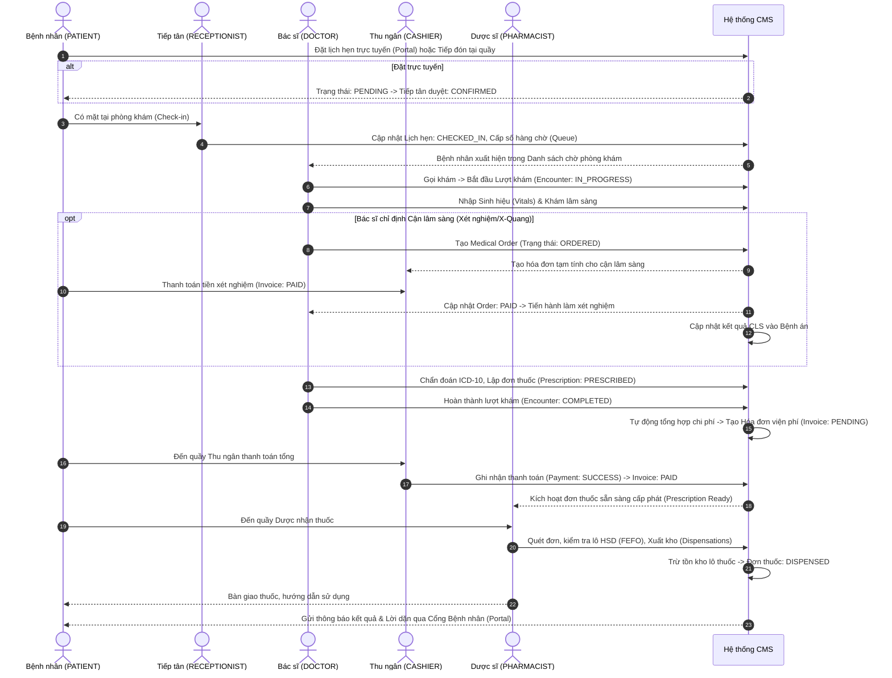
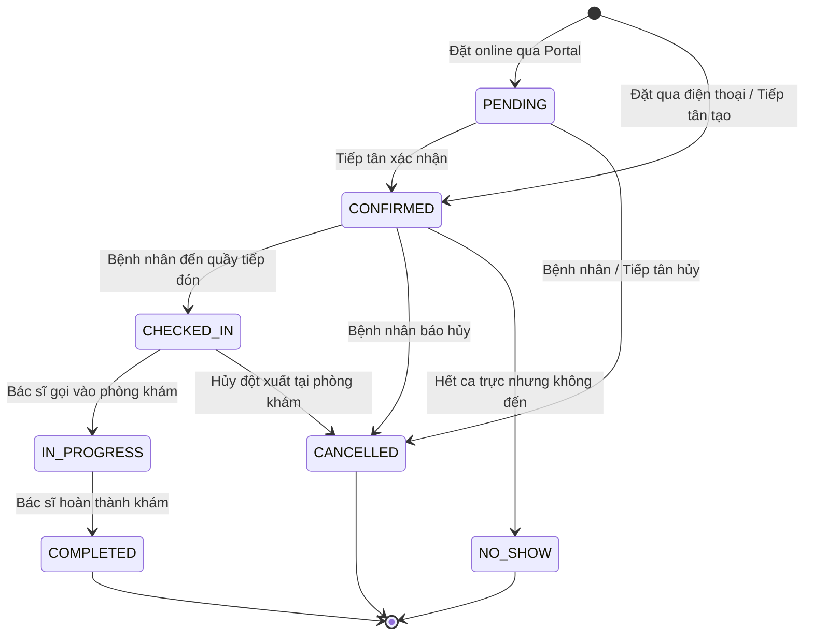
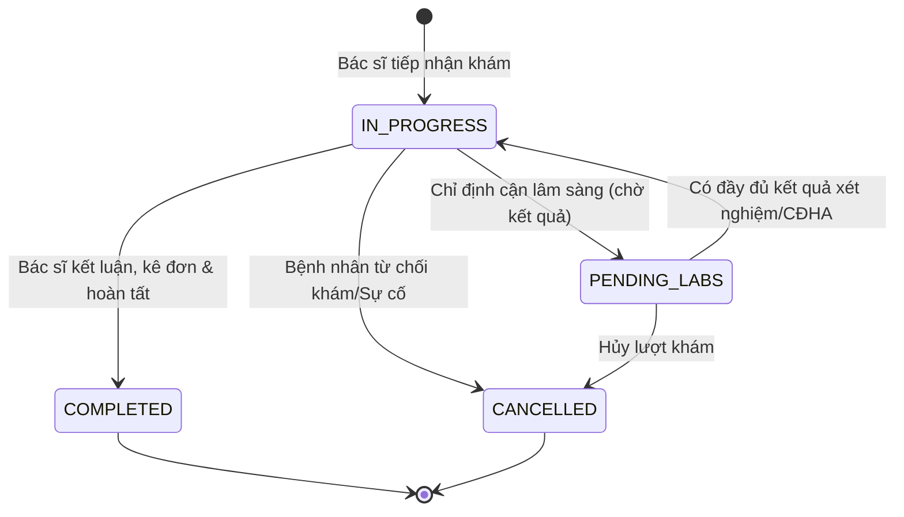
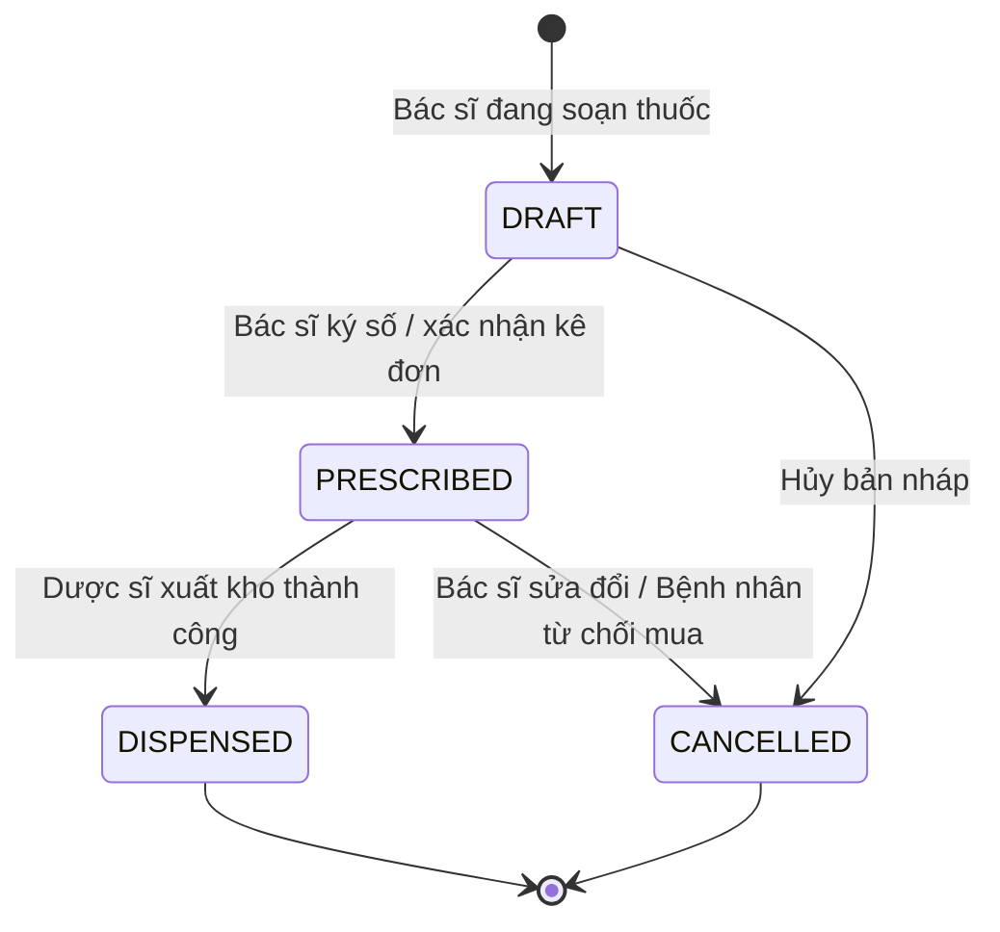
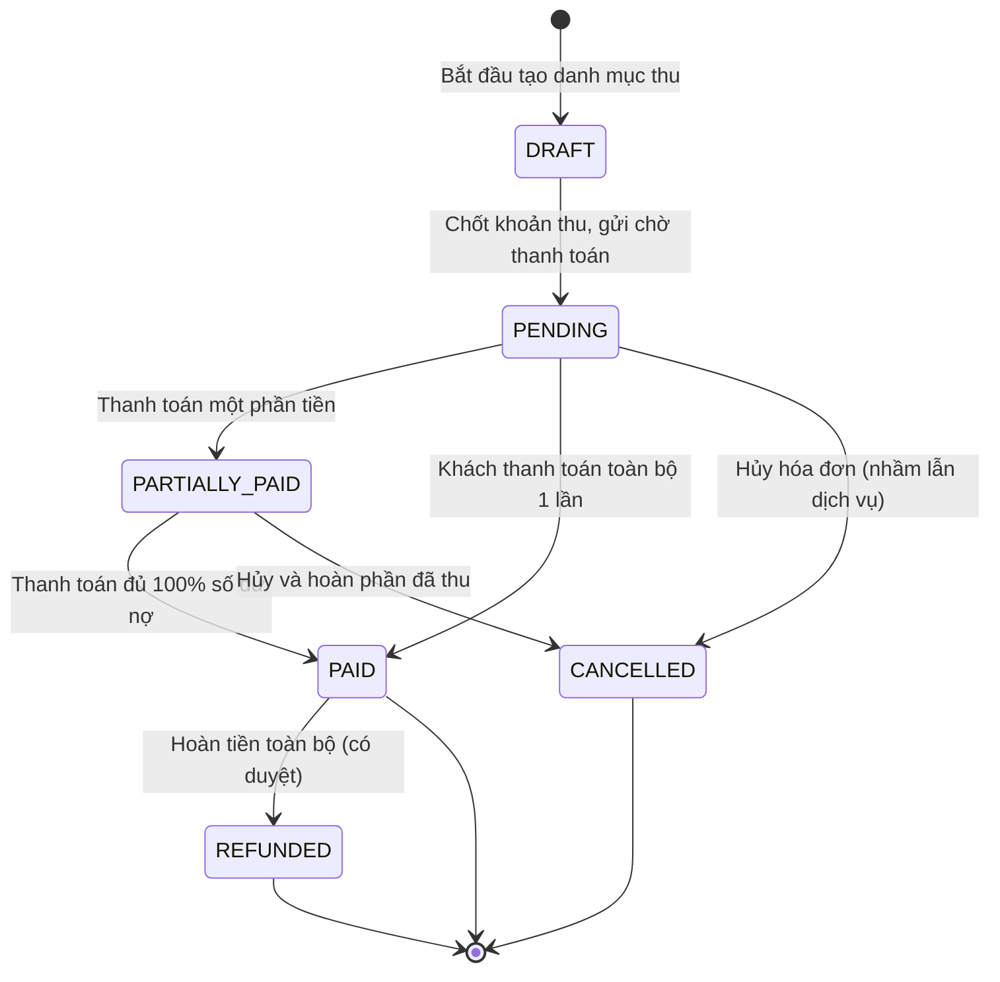
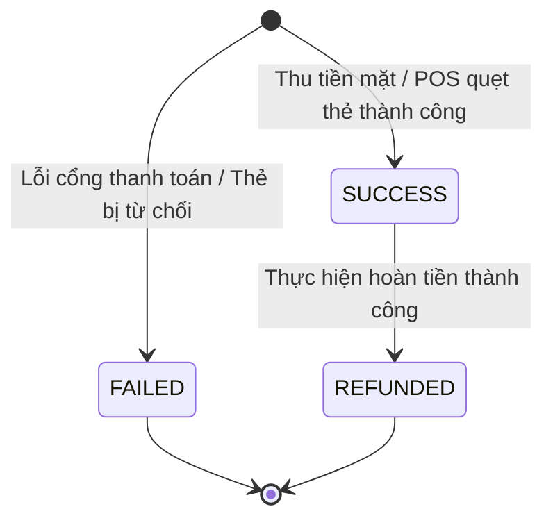

# QUY TRÌNH NGHIỆP VỤ VÀ MÁY TRẠNG THÁI (WORKFLOWS.MD)

> **Mô tả**: Đặc tả chi tiết các máy trạng thái (State Machines), điều kiện chuyển trạng thái, tác vụ kích hoạt (Triggers & Side-effects) và chu trình khám chữa bệnh tổng thể.  
> **Phiên bản**: 1.0.0 | Ngày lập: 2026-10-15

---

## 1. CHU TRÌNH KHÁM CHỮA BỆNH KHÉP KÍN (END-TO-END PATIENT JOURNEY)



---

## 2. ĐẶC TẢ MÁY TRẠNG THÁI (STATE MACHINES)

### 2.1. Máy Trạng thái Lịch hẹn (`AppointmentStatus`)



#### Bảng Quy tắc Chuyển trạng thái Lịch hẹn
| Trạng thái hiện tại | Trạng thái tiếp theo | Người thực hiện | Điều kiện tiên quyết (Preconditions) | Tác vụ phụ đi kèm (Side Effects) |
| :--- | :--- | :--- | :--- | :--- |
| `PENDING` | `CONFIRMED` | RECEPTIONIST | Bác sĩ còn slot trống trong ca trực. | Gửi thông báo SMS/Email xác nhận cho bệnh nhân. |
| `PENDING` / `CONFIRMED` | `CANCELLED` | PATIENT, RECEPTIONIST | Hủy trước giờ hẹn tối thiểu 2 giờ. | Giải phóng slot lịch trực của bác sĩ. |
| `CONFIRMED` | `CHECKED_IN` | RECEPTIONIST | Bệnh nhân có mặt tại quầy, đối soát CCCD/SĐT. | Sinh số thứ tự hàng chờ (`patient_queues`), xếp vào phòng bác sĩ. |
| `CONFIRMED` | `NO_SHOW` | SYSTEM (Auto Job) | Quá giờ hẹn 60 phút mà chưa check-in. | Ghi nhận lịch sử vi phạm hủy hẹn của bệnh nhân. |
| `CHECKED_IN` | `IN_PROGRESS` | DOCTOR | Bác sĩ nhấn nút "Gọi khám" trên Dashboard. | Tự động sinh bản ghi `encounters` liên kết với lịch hẹn. |
| `IN_PROGRESS` | `COMPLETED` | DOCTOR | Bác sĩ hoàn tất khám và lưu bệnh án. | Đánh dấu hoàn tất lượt xếp hàng. |

---

### 2.2. Máy Trạng thái Lượt khám (`EncounterStatus`)



#### Bảng Quy tắc Chuyển trạng thái Lượt khám
| Trạng thái hiện tại | Trạng thái tiếp theo | Người thực hiện | Điều kiện tiên quyết | Tác vụ phụ đi kèm |
| :--- | :--- | :--- | :--- | :--- |
| `IN_PROGRESS` | `PENDING_LABS` | DOCTOR | Đã phát sinh ít nhất 1 chỉ định CLS (`medical_orders`). | Tạm thời đưa bệnh nhân vào trạng thái chờ kết quả phòng xét nghiệm. |
| `PENDING_LABS` | `IN_PROGRESS` | DOCTOR / SYSTEM | Kỹ thuật viên xét nghiệm đã nhập kết quả (`COMPLETED`). | Thông báo cho bác sĩ phòng khám kết quả đã sẵn sàng để đọc lại. |
| `IN_PROGRESS` | `COMPLETED` | DOCTOR | Đã có ít nhất 1 chẩn đoán ICD-10 chính (`PRIMARY`). | Khóa chỉnh sửa hồ sơ bệnh án; Kích hoạt phát hành đơn thuốc và lập hóa đơn. |
| Bất kỳ | `CANCELLED` | DOCTOR, ADMIN | Lượt khám chưa thanh toán hoặc có biên bản hủy. | Ghi nhận Audit Log lý do hủy lượt khám. |

---

### 2.3. Máy Trạng thái Đơn thuốc (`PrescriptionStatus`)



#### Bảng Quy tắc Chuyển trạng thái Đơn thuốc
| Trạng thái hiện tại | Trạng thái tiếp theo | Người thực hiện | Điều kiện tiên quyết | Tác vụ phụ đi kèm |
| :--- | :--- | :--- | :--- | :--- |
| `DRAFT` | `PRESCRIBED` | DOCTOR | Đơn thuốc có ít nhất 1 loại thuốc, liều lượng hợp lệ. | Đẩy dữ liệu khoản tiền thuốc vào bảng tính viện phí `invoices`. |
| `PRESCRIBED` | `DISPENSED` | PHARMACIST | Hóa đơn viện phí chứa đơn thuốc đã được thanh toán (`PAID`). | Trừ kho theo Lô (FEFO), ghi nhận `inventory_transactions`. |
| `PRESCRIBED` | `CANCELLED` | DOCTOR, CASHIER | Chưa xuất kho thuốc (`DISPENSED`). | Hủy dòng thuốc trên hóa đơn, hoàn trả dự trù nếu có. |

---

### 2.4. Máy Trạng thái Hóa đơn (`InvoiceStatus`)



#### Bảng Quy tắc Chuyển trạng thái Hóa đơn
| Trạng thái hiện tại | Trạng thái tiếp theo | Người thực hiện | Điều kiện tiên quyết | Tác vụ phụ đi kèm |
| :--- | :--- | :--- | :--- | :--- |
| `DRAFT` | `PENDING` | SYSTEM / CASHIER | Đã tổng hợp đầy đủ dòng phí dịch vụ và tiền thuốc. | `balance_due = final_amount`. Thông báo sẵn sàng thu tiền. |
| `PENDING` | `PARTIALLY_PAID` | CASHIER | Số tiền thanh toán > 0 nhưng < `final_amount`. | Tạo biên lai thanh toán một phần, cập nhật `balance_due`. |
| `PENDING` / `PARTIALLY_PAID` | `PAID` | CASHIER, PATIENT | Tổng số tiền đã thanh toán `paid_amount == final_amount`. | `balance_due = 0`. Mở khóa cho phép xuất kho thuốc và thực hiện xét nghiệm. |
| `PENDING` | `CANCELLED` | CASHIER, ADMIN | Chưa phát sinh khoản thanh toán nào hoặc lỗi hóa đơn. | Ghi nhận Audit Log lý do hủy. |
| `PAID` | `REFUNDED` | CASHIER, ADMIN | Có đơn đề nghị hoàn tiền đã được Admin phê duyệt. | Sinh bản ghi `refunds`, đảo giao dịch tài chính, hoàn trả kho nếu đã xuất. |

---

### 2.5. Máy Trạng thái Biên lai Thanh toán (`PaymentStatus`)



#### Quy tắc Giao dịch Thanh toán:
- Mỗi giao dịch thanh toán bắt buộc mang một `idempotency_key` duy nhất để chống việc bấm đúp tạo ra nhiều biên lai trùng lặp.
- Mọi giao dịch `SUCCESS` ngay lập tức cập nhật giảm trừ `balance_due` trên hóa đơn tương ứng trong cùng một Spring `@Transactional`.
- Nếu có hoàn tiền, tạo bản ghi trong bảng `refunds` và chuyển trạng thái thanh toán tương ứng sang `REFUNDED`.

---

## 3. QUY TRÌNH XUẤT KHO DƯỢC PHẨM THEO LÔ (FEFO DISPENSING WORKFLOW)

Để đảm bảo thuốc cận hạn sử dụng luôn được ưu tiên xuất trước, hệ thống triển khai thuật toán **FEFO (First Expired, First Out)**:

1. **Bước 1**: Khi Dược sĩ xác nhận xuất thuốc theo đơn, hệ thống tìm các lô thuốc còn hiệu lực trong bảng `medicine_batches`:
   ```sql
   SELECT * FROM medicine_batches 
   WHERE medicine_id = :medicineId 
     AND status = 'ACTIVE' 
     AND current_quantity > 0 
     AND expiry_date >= CURRENT_DATE 
   ORDER BY expiry_date ASC, id ASC 
   FOR UPDATE;
   ```
2. **Bước 2**: Khóa bi quan (`FOR UPDATE`) các bản ghi lô thuốc liên quan.
3. **Bước 3**: Lần lượt trừ tồn kho của lô có `expiry_date` gần nhất:
   - Nếu lô 1 đủ số lượng -> Trừ lô 1, tạo 1 bản ghi `prescription_dispensations` và 1 bản ghi `inventory_transactions`.
   - Nếu lô 1 không đủ -> Trừ hết lô 1 (chuyển trạng thái lô sang `DEPLETED`), tiếp tục trừ phần còn thiếu sang lô 2.
4. **Bước 4**: Cập nhật tổng tồn kho tức thời trên bảng `medicines.current_stock`.
5. **Bước 5**: Hoàn tất giao dịch (`Commit Transaction`). Nếu xảy ra lỗi thiếu tồn kho -> Rollback toàn bộ và trả về mã lỗi `INSUFFICIENT_MEDICINE_STOCK`.
